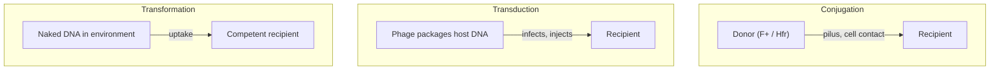
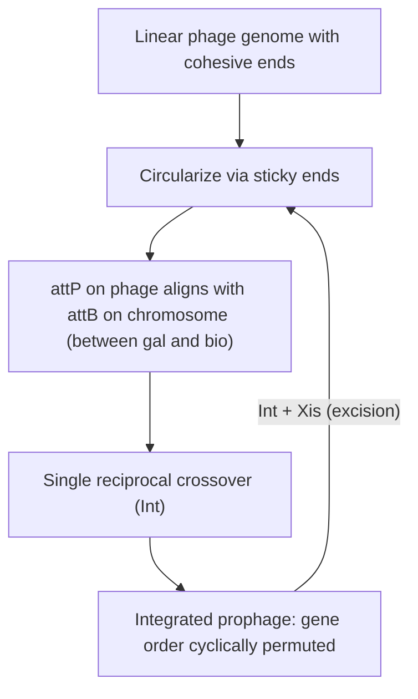
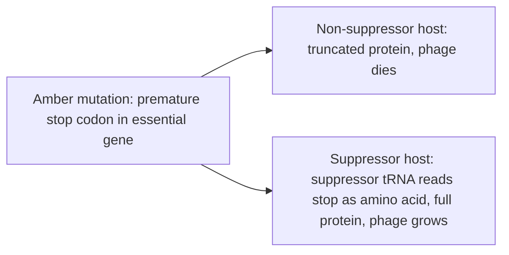
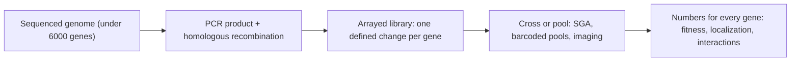
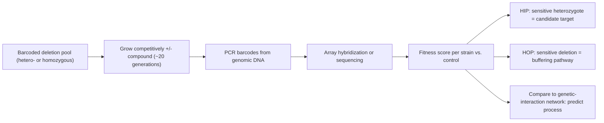
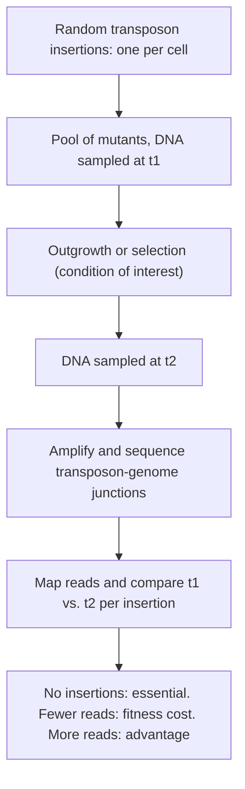
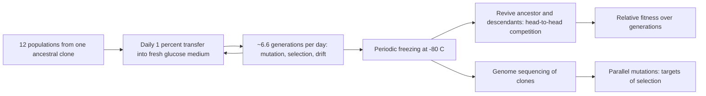

# Genetic Model — Bacteria and Fungi (E. coli and Yeast)

**Course:** BME333 / BIO333 Genetics (UNIST, 2026 Fall) · Lecture 17 · ~60 min
**Syllabus:** [← Course schedule](../../lectures/2026.BME333-BIO333-Syllabus.md) — Week 11 Mon, 2026-11-09
**Languages:** English · [한국어](../../ko/lectures/lec17_Model-Ecoli-Bacteria.md)

## Learning Objectives
By the end of this lecture you should be able to:
- Explain why *E. coli* and its phages became the workhorse of molecular genetics (rapid growth, haploid genome, easy selection).
- Distinguish the three modes of horizontal gene transfer in bacteria: conjugation, transduction, and transformation.
- Describe how conjugation and interrupted-mating mapping revealed the circular *E. coli* chromosome.
- Explain lysogeny and site-specific prophage integration (the Campbell model) and how phage genetics established the fine structure of the gene.
- Describe the genome-wide yeast strain libraries (deletion collection, GFP/TAP tag libraries, conditional alleles) and explain why they turned yeast into a systematic, "make every mutant and measure everything" model.
- Explain chemogenomic profiling in yeast: how haploinsufficiency profiling (HIP) and homozygous profiling (HOP) use gene dosage to find what a drug targets, and what each assay can and cannot tell you.
- Describe how bacterial phenotypic landscapes (Keio collection screened under hundreds of conditions) and transposon-insertion sequencing (Tn-seq, dual Tn-seq) measure gene fitness and genetic interactions.
- Explain what experimental evolution (the *E. coli* Long-Term Evolution Experiment, LTEE) measures, and connect classical bacterial genetics to modern genome engineering and the "microbes in the Modern Synthesis" perspective.

## Lecture

## Part I — Classic bacterial genetics (~34 min)

### 1. Why bacteria? The rise of the microbial model (~5 min)

For the first half of the twentieth century, genetics meant plants, flies, and mice; bacteria were thought to lack genes in any Mendelian sense — no visible chromosomes, no sex, no crosses. That view collapsed in the 1940s, and bacteria then took over molecular genetics because they offer a nearly ideal experimental package. **Generation time** is minutes (an *E. coli* culture doubles every ~20 min), so you can grow *billions* of individuals overnight. Bacteria are **haploid** with a single chromosome, so a recessive mutation shows its phenotype immediately. They grow on chemically **defined media**, so you can demand a specific metabolic capability. And, most powerfully, they permit **selection**: plate 10⁹ cells on a medium only a rare variant can survive, and you recover that one-in-a-billion cell as a colony — events at frequencies of one per million or rarer, utterly invisible in a fly cross.

There was also a conceptual obstacle: did microbes even belong in the theory that the **Modern Synthesis** had built around sexual, diploid populations? Novick and Doolittle note that the architects of the Synthesis (Dobzhansky, Huxley) **often explicitly excluded microbes**, and that lateral gene transfer was later cast as "jeopardizing" the Synthesis (see [en](../../en/review/Novick2019_PLoSGenet_MicrobesModernSynthesis.md) · [ko](../../ko/review/Novick2019_PLoSGenet_MicrobesModernSynthesis.md)). Their resolution is to treat evolutionary theory as a **toolkit of explanatory resources**: microbes **expand the toolkit while clarifying the limited scope** of the Synthesis's original claims. Bacterial genetics did not just add facts; it forced concepts (species, the gene, heredity) to be rebuilt.

**Figure — Why bacteria are ideal for high-resolution genetics.**

| Feature | Consequence for genetics |
|---|---|
| ~20-min generation time | Billions of cells overnight; rare events become observable |
| Haploid single chromosome | Recessive mutations show phenotype immediately |
| Defined minimal media | Can demand a specific metabolic capability |
| Strong selection | Recover one recombinant/mutant in 10⁶–10⁹ as a colony |
| Scorable markers | Auxotrophy, phage resistance, sugar fermentation (color), antibiotic resistance |

### 2. Mutation is spontaneous: fluctuation and pre-existing variants (~5 min)

Before bacteria could be a *genetic* model, one had to prove that bacterial variation is genetic. When phage is added to a sensitive culture, almost all cells lyse but a few resistant survivors grow up. Two hypotheses competed: **acquired immunity (Lamarckian)**, that contact with the phage *induces* resistance; and **mutation (Darwinian)**, that rare resistant mutants arose **before** exposure and the phage merely **selects** them (see [en](../../en/article/LuriaDelbruck1943_Genetics_VirusResistance.md) · [ko](../../ko/article/LuriaDelbruck1943_Genetics_VirusResistance.md)).

Luria and Delbrück (1943) distinguished the two with the **fluctuation test**. Timing predicts *variance*: if resistance is induced at plating, every culture throws up survivors independently, giving a **Poisson** distribution (variance ≈ mean). If resistance arises by spontaneous mutation *during* growth, an early mutation founds a large "**jackpot**" clone, so counts across parallel cultures **fluctuate wildly (variance ≫ mean)**. In Experiment 16 the mean was 11.35 resistant cells, yet **11 of 20 cultures had zero** and **3 had 35–107** — impossible under Poisson. Across ten experiments the mutation rate to resistance averaged **2.45 × 10⁻⁸ per bacterium per division**. This is the founding proof that **selection reveals pre-existing variation rather than creating it**, and the microbial ancestor of our understanding of antibiotic resistance.

**Figure — The fluctuation test logic.**

| | Acquired immunity (Lamarck) | Spontaneous mutation (Darwin) |
|---|---|---|
| When does resistance arise? | At phage exposure | During prior growth, before exposure |
| Distribution across parallel cultures | Poisson (variance ≈ mean) | Highly skewed, "jackpots" (variance ≫ mean) |
| Luria–Delbrück result | rejected | **supported** (Exp. 16: mean 11.35, but many 0s and a few 100+) |

The principle that mutation is **random with respect to fitness** is policed vigilantly. When Cairns and colleagues claimed "directed" or **adaptive mutation**, Franklin Stahl's *Unicorns Revisited* showed how the field handles such a claim: not by dismissing it but by testing and dismantling candidate mechanisms one by one, including, with notable honesty, **his own** (see [en](../../en/review/Stahl1992_Genetics_UnicornsRevisited.md) · [ko](../../ko/review/Stahl1992_Genetics_UnicornsRevisited.md)). The episode was eventually explained by stress-induced mutagenesis and gene amplification — mechanisms that modulate mutation *rate* without "directing" *which* mutation occurs.

### 3. Conjugation and chromosome mapping (~8 min)

Bacteria have no meiosis, yet they exchange genes by three routes of **horizontal (lateral) gene transfer**. In **conjugation**, DNA passes from donor to recipient through **direct cell contact** (a pilus/mating bridge). In **transduction**, a **bacteriophage** accidentally packages host DNA and injects it into a new cell. In **transformation**, a cell takes up **naked DNA** from the environment. The diagnostic difference — contact-dependent vs. filterable vs. DNase-sensitive — is what the classic experiments exploited.

**Figure — Three modes of horizontal gene transfer in bacteria.**

Joshua Lederberg (with Tatum, 1946) discovered conjugation by mixing two **auxotrophic** *E. coli* K-12 strains and plating on minimal medium: rare **prototrophic recombinants** appeared at ~one per million, and doubly marked parents ruled out simple reversion (see [en](../../en/review/Lederberg1987_Genetics_EcoliRecombination.md) · [ko](../../ko/review/Lederberg1987_Genetics_EcoliRecombination.md)). Skeptics (famously Delbrück) suspected artifacts, so Lederberg showed that **unselected markers** — including phage-T1 resistance — segregated cleanly into stable classes among the recombinants, which a cell mixture or heterokaryon could not produce. Accumulating eight markers whose co-segregation implied a **single linkage group**, he drew the first genetic map of *E. coli*.

The map misbehaved, however: Lederberg's 1951 "branched" map was mistakenly taken literally (Watson and Hayes even proposed three chromosomes). The resolution came from the mechanism of transfer. **Hfr** ("high frequency of recombination") donors carry the **F fertility factor integrated into the chromosome**; an Hfr injects its chromosome **linearly, from a fixed origin and always in the same direction**, one gene at a time over ~100 minutes. Wollman and Jacob's **interrupted-mating** experiment made this visible: they let Hfr × F⁻ matings proceed, then agitated the culture in a **blender** at successive times to break the mating bridges, and scored which donor markers had entered. **Genes appear as a function of time** — the earlier a gene enters, the closer it is to the origin — so *time is distance* (in minutes). Different Hfr strains have F integrated at different sites and orientations and so give different linear orders, but **all the orders are consistent with a single circle**: the **circular *E. coli* chromosome**.

**Figure — Interrupted-mating maps the chromosome in minutes and reveals a circle.**

### 4. Transduction: phage-mediated gene transfer (~6 min)

Norton Zinder, a 22-year-old in Lederberg's lab, set out to find conjugation in *Salmonella typhimurium* and instead discovered a **third** transfer mode (see [en](../../en/review/Zinder1992_Genetics_BacterialTransduction.md) · [ko](../../ko/review/Zinder1992_Genetics_BacterialTransduction.md)). Crossing strains LT-2 × LT-22 (5 October 1950) gave prototrophs at high frequency, but the phenomenon was **asymmetric**, moved only **one marker at a time**, and required **no cell contact**. Adapting Bernard Davis's **U-tube** experiment (which had *ruled out* a filterable agent in *E. coli* conjugation), Zinder separated the strains by a **sintered-glass filter** that blocks cells but passes molecules and small particles. In *Salmonella*, transfer **still occurred across the filter**: a **filterable agent** was at work — a **temperate phage** (P22) carried by LT-22 that could package host genes and carry them to LT-2. Lederberg named the process **transduction**.

In **generalized transduction**, the phage occasionally mispackages **any** fragment of host DNA, so two genes are **cotransduced** only if they lie close enough to fit in one phage head; cotransduction frequency measures short-range linkage. In **specialized transduction**, a phage integrated at a **specific site** (like λ, next section) mispackages only the **neighboring** genes when it excises imprecisely (e.g., λ picking up *gal* or *bio*). Zinder's controls established transduction as genuine transfer of **bacterial genetic material packaged in a phage**, all *before* Hershey–Chase and Watson–Crick.

**Figure — Generalized vs. specialized transduction.**

| | Generalized | Specialized |
|---|---|---|
| Which genes transferred | Any region of host genome | Only genes flanking the prophage site (e.g., *gal*, *bio*) |
| Origin of transducing DNA | Random mispackaging of host DNA | Aberrant excision of an integrated prophage |
| Phage type | Often lytic (e.g., P22, P1) | Temperate, site-specific (e.g., λ) |
| Genetic use | Short-range cotransduction mapping | Move/amplify specific loci |

### 5. Lysogeny and prophage integration (~6 min)

A **temperate** phage such as **λ** faces a choice on infection: replicate and burst the cell (the **lytic** cycle) or integrate into the host chromosome and be copied along with it (**lysogeny**), lying dormant as a **prophage** until a stress signal triggers excision and lysis. How does a linear phage genome insert itself into a bacterial chromosome? Allan Campbell's 1961 model answered with pure genetic logic, before any physical proof existed (see [en](../../en/review/Campbell1993_Genetics_ProphageInsertion.md) · [ko](../../ko/review/Campbell1993_Genetics_ProphageInsertion.md)).

The **Campbell model** has two steps. First, the linear λ genome **circularizes** by joining its complementary single-stranded **cohesive ("sticky") ends**. Second, a **single reciprocal crossover** between a phage attachment site (**attP**) and a homologous chromosomal site (**attB**, between the *gal* and *bio* operons) inserts the whole circle into the chromosome. Because insertion opens the circle at *attP*, the model predicted that the **gene order of the prophage is a cyclic permutation** of the free phage's — and observing exactly that was its first triumph. **Int** (integrase) suffices for insertion, while excision requires **Int plus Xis** (excisionase) with host factors — an asymmetry that lets the cell control the direction of the reaction and hence the lysogeny/lysis decision.

**Figure — The Campbell model of λ prophage integration.**

The importance runs deeper than λ. Genetics answered "the chromosome is a **single continuous molecule**" before restriction mapping and sequencing could. λ integration became the **first well-characterized programmed DNA rearrangement**, inspired the (correct) idea that **gene rearrangement generates immunoglobulin diversity (V(D)J recombination)**, and Int is now the founding member of a large **site-specific recombinase (integrase) family** used in genetic engineering (e.g., Gateway cloning).

### 6. Phage genetics and the fine structure of the gene (~4 min)

Phages gave genetics its highest resolution because their huge progeny numbers let rare recombinants within a *single gene* be detected. The key tool was the **conditional-lethal mutation**, lethal in one condition but not another: **temperature-sensitive (ts)** mutants and **amber (nonsense)** mutants. The **amber mutants of phage T4**, discovered by Epstein, Edgar, and colleagues in 1959–1963, carry a premature **chain-termination codon**; they grow on a "permissive" host carrying a **suppressor tRNA** (which reads the stop codon as an amino acid) but not on a non-suppressing host — a clean on/off assay for any essential gene (see [en](../../en/review/Stahl1995_Genetics_AmberMutants-PhageT4.md) · [ko](../../ko/review/Stahl1995_Genetics_AmberMutants-PhageT4.md)). Complementation revealed about **twenty genes** (Delbrück: "How dull!"), but Epstein saw that these generic markers made a **complete developmental analysis** of the phage tractable. The ambers demonstrated the **circularity of the T4 linkage map**, revealed **functional clustering**, and — with Sarabhai et al. (1964) — proved the **colinearity of gene and polypeptide**. Alongside Benzer's fine-structure dissection of the T4 **rII** region, this redefined the gene as a divisible linear array of mutable sites.

**Figure — How an amber (nonsense) mutation gives a conditional-lethal phenotype.**

Bacterial genetics also showed that even **behavior** is genetically dissectable: Adler and Parkinson isolated *E. coli* **chemotaxis** mutants, treating sensory signaling as a pathway to be reconstructed by mutation (see [en](../../en/review/Parkinson1987_Genetics_BehavioralGenetics-Bacteria.md) · [ko](../../ko/review/Parkinson1987_Genetics_BehavioralGenetics-Bacteria.md)). And the same selection-and-recombination logic scales into the present: from IS elements and transposition (Shapiro's "natural genetic engineering," a precursor to genome editing) to designer genomes, *E. coli* remains where genomes are read *and rewritten* (see [en](../../en/review/Shapiro2009_Genetics_Perspective-Ecoli-GenomeEng.md) · [ko](../../ko/review/Shapiro2009_Genetics_Perspective-Ecoli-GenomeEng.md)). The second half of the lecture picks up that thread.

## Part II — Modern functional genomics of microbes (~26 min)

Classical genetics worked **forward**: find a mutant with an interesting phenotype, then trace it to a gene. Once genomes were sequenced, the question reversed — if we can make *every* mutant, what does each one do? Yeast and *E. coli* are the two organisms in which this became a routine, systematic enterprise, and the unifying idea of this half is that a **single, well-defined collection of mutants, measured under many conditions, turns genotype–phenotype relationships into a numerical dataset**.

### 7. Yeast: the eukaryotic microbe and genome-wide libraries (~6 min)

*Saccharomyces cerevisiae* offers the microbial package of Section 1 — fast growth (a ~90-minute doubling time, per Simon and Bedalov), cheap media, easy genetics — in a **eukaryotic** cell, and it carries haploid and diploid forms (MATa, MATα and diploid strains all exist in the collections). Baruch, Schuldiner and Klein, in a 2026 survey, give two reasons yeast became the home of **systematic strain libraries**: it was the **first sequenced eukaryote** (fewer than 6,000 protein-coding genes), and it has efficient **PCR-mediated homologous recombination**, so a defined modification can be targeted to any gene by supplying a PCR product with short homology arms (see [en](../../en/review/Baruch2026_FEBSJ_YeastLibraries-Overview.md) · [ko](../../ko/review/Baruch2026_FEBSJ_YeastLibraries-Overview.md)). Libraries replaced laborious random-mutagenesis screens in which each mutant had to be traced back to its gene, and they are cited in roughly 15,000 papers. Their deeper value is that every gene is compared in **one systematic experiment**, giving numerical measures of functional relationships and networks.

The first-generation collections set the pattern. The **yeast knockout (YKO) library** deletes each gene and tags it with molecular **barcodes** (UPTAG/DNTAG) so strains can be pooled and counted; it exists in haploid and diploid forms, with **essential genes** (1,105 in rich glucose medium) studied as heterozygotes. The **C-terminal GFP library** reports live-cell localization of each protein from its native promoter, and the **TAP-tag library** showed that about 80% of the proteome is expressed in rich medium, with levels from fewer than 50 to more than 1,000,000 molecules per cell. The deletion collection also enabled **synthetic genetic array (SGA)** analysis of genetic interactions, and SGA lets any library be crossed into a donor to build custom collections (for example, a tagged protein in every deletion background). Table 1 of the review lists roughly 5,120 deleted genes, 5,206 GFP fusions and 4,715 TAP fusions. Later generations filled gaps — essential genes can be studied with repressible promoters, temperature-sensitive alleles (permissive 25 °C, restrictive 32–37 °C), DAmP hypomorphs (3′ UTR replacement lowering transcript 2- to 10-fold) and **auxin-inducible degrons** that deplete a protein on demand and avoid compensatory adaptation; the **SWAT** platform allows tags and promoters to be swapped within one library. The authors also warn of well-to-well contamination and secondary or suppressor mutations, and recommend validating strains by PCR or sequencing.

**Figure — Genome-wide yeast libraries and what each one measures.**

| Library | What is modified in every gene | Typical readout |
|---|---|---|
| YKO deletion (barcoded) | Gene deleted (essentials as heterozygotes) | Fitness in pooled growth; SGA genetic interactions |
| GFP fusion (C-terminal) | Protein tagged under native promoter | Subcellular localization |
| TAP-tag | Affinity tag | Abundance (about 80% of proteome expressed), complexes, half-life |
| Repressible / inducible promoter, ts, DAmP | Expression or activity of essential genes lowered | Depletion phenotypes of essential genes |
| Auxin-inducible degron (AID) | Protein degraded on demand | Acute loss of function without long-term compensation |
| SWAT | Tag or promoter swappable in one library | Custom libraries from a single parent |

**Figure — From a genome sequence to a systematic phenotype map.**

### 8. Chemogenomics: finding what a drug hits (~7 min)

Here the yeast deletion collection meets pharmacology. Bredel and Jacoby frame the problem: pharmacological compounds have been found to act on the products of roughly 400–500 genes over five decades, yet only about 120 are targets of marketed drugs, while the Human Genome Project suggested several thousand drug-susceptible genes (see [en](../../en/review/Bredel2004_NatRevGenet_Chemogenomics.md) · [ko](../../ko/review/Bredel2004_NatRevGenet_Chemogenomics.md)). They sort chemogenomics by classical-genetics logic: **reverse** (start from a purified target, screen compounds against it) versus **forward** (start from a phenotype in cells or organisms, then find the target of active compounds). Jones and Bunnage add the drug-industry view: most clinical attrition is lack of efficacy, phenotypic screens hit targets that are unknown, and a **chemogenomic library** of well-annotated, selective compounds can turn a phenotypic hit into a target hypothesis (see [en](../../en/review/Jones2017_NatRevDrugDiscov_ChemogenomicLibraryScreening.md) · [ko](../../ko/review/Jones2017_NatRevDrugDiscov_ChemogenomicLibraryScreening.md)). Yeast offers a genetic route to the same goal.

The key idea is **gene dosage**. Giaever et al. (1999) showed that a heterozygous diploid yeast, carrying one copy of a gene instead of two, becomes hypersensitive to a drug that inhibits that gene's product — **drug-induced haploinsufficiency** (see [en](../../en/article/Giaever1999_NatGenet_InducedHaploinsufficiency.md) · [ko](../../ko/article/Giaever1999_NatGenet_InducedHaploinsufficiency.md)). Heterozygotes for six known targets (*HIS3*, *ALG7*, *RNR2*, *TUB1/TUB2*, *ERG11*) were each hypersensitive to the matching drug and to no other; for instance *alg7/ALG7* was inhibited at 0.5 µg/ml tunicamycin, where wild type grew normally. They then pooled strains carrying unique 20-base **barcodes**, grew them competitively with or without drug, and read abundance by PCR and array hybridization. In a 233-strain pool only three strains were tunicamycin-sensitive: *alg7/ALG7* (the known target) and two others whose homozygous deletions were also sensitive, so they were "hypersensitivity" loci rather than targets. Giaever et al. (2004) scaled this to the full collection of about 6,000 heterozygous strains (5,918 analyzed), ~20 generations of pooled growth, and 80 genome-wide experiments with 10 compounds (see [en](../../en/article/Giaever2004_PNAS_ChemogenomicProfiling.md) · [ko](../../ko/article/Giaever2004_PNAS_ChemogenomicProfiling.md)). Methotrexate identified its known target *DFR1* plus upstream folate-synthesis genes (*FOL1*, *FOL2*) in eight of nine replicates. 5-Fluorouracil, in contrast, did *not* score thymidylate synthase; its 22 sensitive genes were enriched for rRNA processing and ribosome biogenesis (P ≈ 4 × 10⁻⁹), pointing to RNA misincorporation as the main growth-inhibitory mechanism in yeast. Cisplatin gave no heterozygous hits, but the **homozygous** pool revealed DNA-repair genes. The assay finds two classes of genes: dosage-limiting direct interactors and genes affecting drug availability (transport, efflux, metabolism); target specificity is lost at high drug doses.

Smith, Ammar, Nislow and Giaever's 2010 survey lays out the whole toolkit built on the barcoded collection (see [en](../../en/review/Smith2010_PharmacolTher_YeastChemicalGenomicAssays.md) · [ko](../../ko/review/Smith2010_PharmacolTher_YeastChemicalGenomicAssays.md)). **HIP** screens heterozygous diploids and often names the target directly — across more than 2,000 compounds screened, HIP had not yet failed to identify a well-characterized, growth-limiting target. **HOP** uses complete deletions of non-essential genes; the target is absent, so HOP instead reveals genes that **buffer** the target pathway (e.g., DNA-repair modules for DNA-damaging agents). **Multi-copy suppression profiling** looks for resistance by overexpression, and comparative expression profiling matches drug-induced transcript profiles to mutant profiles. Limits include targets absent from yeast, redundant targets, and the high compound concentrations needed because of the cell wall and efflux pumps. Simon and Bedalov show how to overcome the permeability problem and use yeast for anticancer discovery: in an NCI screen of more than 100,000 compounds, strains lacking *ERG6* and *PDR1/PDR3* showed roughly 25% of compounds with a more-than-tenfold increase in growth inhibition; and in a pathway screen of 6,000 NCI compounds a telomere-proximal *URA3* reporter identified **splitomicin** as a Sir2 inhibitor, whose expression profile matched a *sir2* mutant (see [en](../../en/review/Simon2004_NatRevCancer_YeastAnticancerDrugDiscovery.md) · [ko](../../ko/review/Simon2004_NatRevCancer_YeastAnticancerDrugDiscovery.md)).

**Figure — HIP vs. HOP: what each chemogenomic assay reports.**

| | HIP (haploinsufficiency profiling) | HOP (homozygous profiling) |
|---|---|---|
| Strains screened | Heterozygous diploid deletions (essential and non-essential genes) | Complete deletions of non-essential genes |
| Gene dosage of the target | Halved (one copy) | Zero (target gene absent) |
| Most sensitive strain tends to be | The drug target (or a rate-limiting pathway step) | A buffering or compensating gene (e.g., DNA repair) |
| Typical example | *DFR1* for methotrexate; *ALG7* for tunicamycin | DNA-repair genes for cisplatin |
| Main caveat | Misses redundant, non-essential or non-yeast targets; drug-availability genes also score | Target itself is not directly revealed |

Modern platforms replace microarrays with sequencing and add network interpretation. Piotrowski et al. (2017) built a **drug-sensitized background** (*pdr1 pdr3 snq2*, raising the number of growth-inhibiting compounds about 5-fold, with ~35% average hit rate across 13,524 compounds), a diagnostic pool of **310 deletion mutants** covering the 17 major biological processes of the yeast genetic-interaction network, and a 768-plex barcode-sequencing protocol; each chemical-genetic profile was compared with genome-wide genetic-interaction profiles to predict the process a compound perturbs, yielding 1,522 high-confidence profiles across seven libraries (see [en](../../en/article/Piotrowski2017_NatChemBiol_ChemicalLibraryAnnotation.md) · [ko](../../ko/article/Piotrowski2017_NatChemBiol_ChemicalLibraryAnnotation.md)). The logic is epistasis again: a drug is a "phenocopy" of a mutation in its target pathway. Zhou et al. (2019) applied the same pipeline to the 333,200-compound Chinese National Compound Library: 5,360 compounds (1.6%) inhibited growth, 1,109 had high-confidence process predictions, and 78% of those resembled at least one approved drug. Testing in human cells, 14 of 38 compounds predicted to resemble known autophagy inducers raised GFP-LC3 puncta, and a compound predicted to resemble the Wnt inhibitor FH535 acted on a **pathway absent from yeast**, with an IC50 (7.44 µM) matching FH535 (7.43 µM) (see [en](../../en/article/Zhou2019_ActaPharmacolSin_YeastChemicalGenomicsMammalianPathways.md) · [ko](../../ko/article/Zhou2019_ActaPharmacolSin_YeastChemicalGenomicsMammalianPathways.md)). Chemogenomics is not limited to drugs: Fletcher et al. (2021) screened the haploid deletion array on 80 mM adipic acid (the nylon-6,6 precursor, toxic to yeast and so a limit on engineered production), found 77 sensitive mutants (43 confirmed), enriched for ergosterol biosynthesis and protein trafficking (ESCRT, GARP, COG), and a single suppressor, *KGD1* (see [en](../../en/article/Fletcher2021_iScience_AdipicAcidToxicity-Chemogenomics.md) · [ko](../../ko/article/Fletcher2021_iScience_AdipicAcidToxicity-Chemogenomics.md)). Finally, the assays need not be elaborate: Hung et al. (2018) give a 96-well liquid-culture protocol that yields an **IC50** with an ordinary plate reader, and show it both detects defects not apparent on plates (deleting *ENT3* lowers the calcofluor-white IC50 of *chs6* cells about 2-fold) and saves time (the ~3-fold canavanine hypersensitivity of *art1* cells is visible within 24 h, versus 5 days on plates) (see [en](../../en/article/Hung2018_SciRep_YeastChemicalSensitivity-IC50.md) · [ko](../../ko/article/Hung2018_SciRep_YeastChemicalSensitivity-IC50.md)).

**Figure — Anatomy of a pooled chemogenomic screen in yeast.**

### 9. Bacterial functional genomics: phenotypic landscapes and Tn-seq (~7 min)

*E. coli* has its own deletion collection, the **Keio** collection of single-gene knockouts. Bacteria are **monoploid**, so the heterozygote trick of HIP is not available; Pathania et al. (2009) instead used **high-copy suppression**, overexpressing an ordered array of essential *E. coli* genes and asking which one rescues growth in a compound (see [en](../../en/article/Pathania2009_NatChemBiol_EcoliLipoproteinTargeting-MAC13243.md) · [ko](../../ko/article/Pathania2009_NatChemBiol_EcoliLipoproteinTargeting-MAC13243.md)). Known antibiotics' targets emerged (fosfomycin–*murA*, trimethoprim–*folA*, D-cycloserine–*ddl*, and others), each antibiotic with its own suppressor profile. A new compound from a ~50,000-molecule screen, **MAC13243**, was suppressed by overexpressing **LolA**, a periplasmic chaperone of lipoprotein trafficking; the compound caused Braun's lipoprotein to accumulate in the inner membrane, bound purified LolA directly (Kd = 7.5 ± 3 µM), and was active against Gram-negative but not Gram-positive bacteria (which lack the Lol pathway).

The scale-up of the single-knockout idea is the **phenotypic landscape**. Nichols et al. (2011) screened the Keio library, essential-gene hypomorphs and small RNA/protein knockouts (arrayed at 1,536 colonies per plate) in **324 conditions** covering 114 unique stresses, producing a matrix of 3,979 mutants × 324 conditions (see [en](../../en/article/Nichols2011_Cell_PhenotypicLandscapeBacterialCell.md) · [ko](../../ko/article/Nichols2011_Cell_PhenotypicLandscapeBacterialCell.md)). Gene pairs whose phenotypic signatures correlate at r = 0.6–0.8 were more than 100-fold enriched for common operon membership and 150-fold for known protein interactions. At 5% FDR, 49% of strains (1,957/3,979) showed at least one phenotype (13,497 phenotypes in all, about 80% negative), and 197 conditionally essential genes were identified, raising the number of known essential genes by about 30%. The signatures also assign function: the uncharacterized *marB* behaved like the repressor *marR*, and sulfonamides and trimethoprim, though strongly synergistic, had weakly correlated profiles (r = 0.15). Lao et al. (2026) extend the Keio resource in the time dimension, releasing growth curves for 3,909 knockouts in LB and M63 glucose minimal medium — 23,454 trajectories in biological triplicate, with carrying capacity *K* and maximum growth rate *r* extracted from each (see [en](../../en/article/Lao2026_SciData_EcoliKeio-GrowthCurves.md) · [ko](../../ko/article/Lao2026_SciData_EcoliKeio-GrowthCurves.md)).

Arrayed collections need a strain per gene. **Transposon-insertion sequencing (TIS)** does not. van Opijnen, Bodi and Camilli (2009) introduced **Tn-seq**: a mariner transposon (*magellan6*, needing only a TA dinucleotide) inserts almost randomly, a pool is grown, and Illumina sequencing of the transposon–genome junctions before and after growth gives each insertion's fitness (see [en](../../en/article/VanOpijnen2009_NatMethods_TnSeq-FitnessGeneticInteraction.md) · [ko](../../ko/article/VanOpijnen2009_NatMethods_TnSeq-FitnessGeneticInteraction.md)). In *Streptococcus pneumoniae* (strain AC2394, an acapsular derivative of TIGR4; six libraries of ~25,000 insertions, ~7 generations), 76% of genes were neutral, 6% advantageous, 2% disadvantageous and 16% possibly essential (no insertions recovered). Fitness matched classical competition assays for 30 mutants. To find **genetic interactions** — a double mutant deviating from the multiplicative expectation of the single mutants — they made libraries in five query-gene deletion backgrounds, finding 97 high-confidence interactions, with the master catabolite regulator *ccpA* a hub (64 partners, half of them carbohydrate uptake and metabolism genes). Cain et al. (2020) review ten years of TIS (Tn-Seq, TraDIS, INSeq, HITS): the workflow is a saturated library, optional challenge, sequencing and mapping; genes with no insertions are candidate essentials, and genes whose insertion frequency falls under a condition are needed for fitness there; advances include outward-facing promoters for essential genes, barcoded transposons (RB-Tn-Seq applied to 32 bacteria in about 130-200 conditions, a range because the review gives both figures), and infection models limited by population bottlenecks (see [en](../../en/review/Cain2020_NatRevGenet_TIS-DecadeOfAdvances.md) · [ko](../../ko/review/Cain2020_NatRevGenet_TIS-DecadeOfAdvances.md)). Conventional Tn-seq is "one-to-all": a query gene must be mutated first. Zik et al. (2025) made it **"all-to-all"** with **dual Tn-seq**: two barcoded mariner transposons, each carrying a lox site, whose barcodes Cre recombination fuses into one readable dual barcode; crossing ~620,000 and ~230,000 mutant libraries in *S. pneumoniae* D39W produced ~1.4 billion double mutants and covered 958,696 non-essential gene pairs (73%) (see [en](../../en/article/Zik2025_Science_DualTnSeq-GeneticInteraction.md) · [ko](../../ko/article/Zik2025_Science_DualTnSeq-GeneticInteraction.md)). Of 107 tested pairs, 15 were synthetic lethal; the screen revealed that the unknown gene Spd_0310 interacts with *pyrG* and encodes an alternative CTP synthase, renamed PyrJ (UTP to CTP using ammonia).

**Figure — Tn-seq workflow: from a random insertion pool to gene fitness.**

**Figure — Arrayed collection vs. Tn-seq pool vs. dual Tn-seq.**

| | Keio phenotypic landscape | Tn-seq | Dual Tn-seq |
|---|---|---|---|
| Starting material | Arrayed single-gene knockouts | Pooled random insertions | Pooled double-insertion libraries |
| Scale in the notes | 3,979 mutants × 324 conditions | ~25,000 insertions per library | ~1.4 billion double mutants |
| Question answered | Which conditions does each gene matter in? | Gene fitness; interactions with a chosen query gene | Interactions between nearly all non-essential gene pairs |
| Organism in the notes | *E. coli* K-12 | *S. pneumoniae* (TIGR4 derivative AC2394) | *S. pneumoniae* D39W |

### 10. Evolving and engineering microbes (~4 min)

The last use of microbes is to watch evolution happen. Lenski's **Long-Term Evolution Experiment (LTEE)** began in 1988 with 12 *E. coli* populations founded from one ancestral strain, each propagated daily in glucose-limited minimal medium by a 1% (100-fold) transfer — about 6.6–6.7 generations per day — with samples frozen at −80 °C, so ancestors and descendants can be revived and competed head-to-head ("time travel") (see [en](../../en/review/Lenski2017_ISMEJ_ExperimentalEvolution-LTEE.md) · [ko](../../ko/review/Lenski2017_ISMEJ_ExperimentalEvolution-LTEE.md)). Fitness is measured as **relative fitness**, the ratio of realized growth rates of evolved and ancestral cells in direct competition, distinguished by a neutral arabinose-utilization marker. Fitness rose ~30% in about three steps in the first 2,000 generations; the grand-mean fitness reached ~1.7 by 50,000 generations, with the rate of improvement slowing but, in a power-law model, without an upper bound. The "simple" experiment evolved complexity: population Ara-2 diverged into stably coexisting L and S ecotypes maintained by cross-feeding; six populations became hypermutable (~100-fold higher point-mutation rate); and after ~31,000 generations population Ara-3 evolved aerobic growth on **citrate**, through a tandem duplication of *citT* that placed a copy under a new promoter. Replays showed **historical contingency**: no Cit+ mutants arose from the ancestor or from clones before generation 20,000. Sequencing of 264 clones found ~75 mutations per non-hypermutable clone at 50,000 generations, with 57 genes (~2% of coding sequence) carrying half of nonsynonymous mutations — parallel evolution that marks targets of selection.

Lenski (2023) revisits why the design works: daily serial transfer (cheap, precise, contamination-resistant), a single limiting resource (glucose at 25 µg/mL, to minimize frequency-dependent selection), an ancestor (REL606) with no plasmids or functional prophages and no natural transformation (so **no horizontal gene transfer**), and each population started from a single haploid cell, so every mutation arose independently and convergence is true **parallel evolution** (see [en](../../en/review/Lenski2023_JMolEvol_LTEE-Design.md) · [ko](../../ko/review/Lenski2023_JMolEvol_LTEE-Design.md)). The ancestor derives from *E. coli* B, the strain of Luria and Delbrück (Section 2) — and the LTEE relies on exactly the spontaneous, random mutation they demonstrated. Pantoja-Alonso et al. (2025) trace the other direction, from random to rational: adaptive laboratory evolution (since 1951) and UV and chemical mutagenesis, then site-specific recombinases and transposons, then recombineering (Datsenko and Wanner's λ Red method, which produced the Keio collection), MAGE (2009) and CRISPR/Cas (2012), whose editing efficiencies are reported as about 50–90% versus 10–40% for earlier techniques (see [en](../../en/review/PantojaAlonso2025_Microbiology_GenomeEngineering-BacterialProductivity.md) · [ko](../../ko/review/PantojaAlonso2025_Microbiology_GenomeEngineering-BacterialProductivity.md)). That closes the loop with Shapiro's "natural genetic engineering" in Section 6 (see [en](../../en/review/Shapiro2009_Genetics_Perspective-Ecoli-GenomeEng.md) · [ko](../../ko/review/Shapiro2009_Genetics_Perspective-Ecoli-GenomeEng.md)): the cell's own recombinases and transposons became tools we now aim deliberately.

**Figure — The experimental-evolution loop (LTEE) and what is measured.**

### 11. Wrap-up & discussion (~2 min)

In one lecture we went from proving that bacterial variation is genetic (Luria–Delbrück) to mapping a chromosome by the clock (interrupted mating), to three mechanisms of gene transfer and the anatomy of prophage integration and of the gene itself. Then we saw the same microbes turned into *systematic* tools: barcoded deletion pools in yeast that tell a drug's target from its dosage sensitivity, phenotypic landscapes and Tn-seq in bacteria that give every gene a fitness in every condition, and a 35-year evolution experiment that replays evolution. The through-line is that **strong selection plus huge numbers plus clever design** let microbes resolve genetics finer than any multicellular organism, and that once every gene can be perturbed and counted, genetics becomes quantitative.

## Key Takeaways
- Bacteria are ideal for high-resolution genetics: **fast growth, haploid single chromosome, defined media, and powerful selection** make one-in-a-million events visible.
- The **Luria–Delbrück fluctuation test** proved mutations are **spontaneous and pre-selective** (jackpots ⇒ variance ≫ mean; rate ~2.45 × 10⁻⁸), the basis for understanding antibiotic resistance.
- Bacteria exchange genes by three routes: **conjugation** (contact), **transduction** (phage-mediated), and **transformation** (naked DNA).
- **Interrupted-mating** with **Hfr** donors maps genes in **minutes** (time = distance); combining Hfr strains proved the *E. coli* chromosome is **circular**.
- **Transduction** (Zinder & Lederberg) is generalized or specialized; **cotransduction frequency** measures short-range linkage.
- The **Campbell model**: λ circularizes via sticky ends and inserts by a **single crossover** (attP × attB), cyclically permuting gene order; **Int** integrates, **Int+Xis** excise — the first programmed DNA rearrangement and the conceptual parent of V(D)J recombination.
- **Amber (nonsense) and ts conditional-lethal** mutants in phage T4 established the circular map, gene clustering, and **gene–protein colinearity**, taking the gene down to nucleotide resolution.
- Yeast **genome-wide libraries** (barcoded deletion collection, GFP/TAP tags, conditional alleles, SGA, SWAT) exist because yeast was the first sequenced eukaryote and recombines PCR products efficiently; they let every gene be compared in one experiment.
- **HIP** exploits gene dosage: the heterozygote for a drug's target gene is hypersensitive, so the most-depleted strain in a barcoded pool often names the target; **HOP** (complete deletions) instead reveals **buffering** pathways, and the two together separate target from compensation.
- Chemical-genetic profiles can be compared with the yeast **genetic-interaction network** to predict the biological process a compound perturbs, and those predictions transfer to mammalian pathways, including ones absent from yeast.
- In bacteria, **phenotypic landscapes** (Keio mutants in 324 conditions) and **Tn-seq / dual Tn-seq** give genome-wide fitness and genetic interactions without a strain-per-gene array; genes with no insertions are essential, and double-insertion screens find synthetic interactions and new gene functions.
- The **LTEE** shows that evolution in a simple, constant environment yields repeated (parallel) mutations, diminishing-but-unbounded fitness gains, and contingent innovations such as citrate use; genome-engineering tools (recombineering, MAGE, CRISPR) now let us write the changes deliberately.

## Textbook Reading
- **Genetics: From Genes to Genomes (8e)** — Ch. 16 Bacterial Genetics. → [textbook ref](../../lectures/ref.Genetics-FromGenesToGenomes.md)

## Notes in this vault
Papers to read alongside this lecture (each has a bilingual en/ko pair).

**Classic bacterial genetics**
- `Lederberg1987_Genetics_EcoliRecombination` — first-hand account of discovering recombination/conjugation in *E. coli*; anchors the chromosome-mapping story. · [en](../../en/review/Lederberg1987_Genetics_EcoliRecombination.md) · [ko](../../ko/review/Lederberg1987_Genetics_EcoliRecombination.md)
- `LuriaDelbruck1943_Genetics_VirusResistance` — the fluctuation test; mutations are spontaneous and pre-selective — the founding quantitative experiment. · [en](../../en/article/LuriaDelbruck1943_Genetics_VirusResistance.md) · [ko](../../ko/article/LuriaDelbruck1943_Genetics_VirusResistance.md)
- `Zinder1992_Genetics_BacterialTransduction` — discovery of transduction; introduces phage-mediated gene transfer for mapping. · [en](../../en/review/Zinder1992_Genetics_BacterialTransduction.md) · [ko](../../ko/review/Zinder1992_Genetics_BacterialTransduction.md)
- `Campbell1993_Genetics_ProphageInsertion` — the Campbell model of site-specific prophage integration; core of the lysogeny segment. · [en](../../en/review/Campbell1993_Genetics_ProphageInsertion.md) · [ko](../../ko/review/Campbell1993_Genetics_ProphageInsertion.md)
- `Parkinson1987_Genetics_BehavioralGenetics-Bacteria` — bacterial chemotaxis as "behavioral genetics," showing bacteria as a model for signaling and behavior. · [en](../../en/review/Parkinson1987_Genetics_BehavioralGenetics-Bacteria.md) · [ko](../../ko/review/Parkinson1987_Genetics_BehavioralGenetics-Bacteria.md)
- `Stahl1992_Genetics_UnicornsRevisited` — reflections on phage recombination and the logic of genetic crosses. · [en](../../en/review/Stahl1992_Genetics_UnicornsRevisited.md) · [ko](../../ko/review/Stahl1992_Genetics_UnicornsRevisited.md)
- `Stahl1995_Genetics_AmberMutants-PhageT4` — amber (nonsense) conditional mutants in T4; how phage genetics dissected gene function. · [en](../../en/review/Stahl1995_Genetics_AmberMutants-PhageT4.md) · [ko](../../ko/review/Stahl1995_Genetics_AmberMutants-PhageT4.md)
- `Novick2019_PLoSGenet_MicrobesModernSynthesis` — historical/conceptual framing of how microbes entered evolutionary genetics. · [en](../../en/review/Novick2019_PLoSGenet_MicrobesModernSynthesis.md) · [ko](../../ko/review/Novick2019_PLoSGenet_MicrobesModernSynthesis.md)
- `Shapiro2009_Genetics_Perspective-Ecoli-GenomeEng` — from classical *E. coli* genetics toward genome engineering; bridges to the modern era. · [en](../../en/review/Shapiro2009_Genetics_Perspective-Ecoli-GenomeEng.md) · [ko](../../ko/review/Shapiro2009_Genetics_Perspective-Ecoli-GenomeEng.md)

**Yeast and chemogenomics**
- `Baruch2026_FEBSJ_YeastLibraries-Overview` — survey of arrayed yeast libraries (deletion, GFP/TAP, conditional alleles, SWAT); why yeast supports systematic genetics. · [en](../../en/review/Baruch2026_FEBSJ_YeastLibraries-Overview.md) · [ko](../../ko/review/Baruch2026_FEBSJ_YeastLibraries-Overview.md)
- `Giaever1999_NatGenet_InducedHaploinsufficiency` — drug-induced haploinsufficiency; heterozygous strains reveal a drug's target; first bar-coded pool. · [en](../../en/article/Giaever1999_NatGenet_InducedHaploinsufficiency.md) · [ko](../../ko/article/Giaever1999_NatGenet_InducedHaploinsufficiency.md)
- `Giaever2004_PNAS_ChemogenomicProfiling` — HIP scaled to ~6,000 heterozygous strains; target and drug-availability genes. · [en](../../en/article/Giaever2004_PNAS_ChemogenomicProfiling.md) · [ko](../../ko/article/Giaever2004_PNAS_ChemogenomicProfiling.md)
- `Smith2010_PharmacolTher_YeastChemicalGenomicAssays` — survey of HIP, HOP, multi-copy suppression and expression-profiling assays. · [en](../../en/review/Smith2010_PharmacolTher_YeastChemicalGenomicAssays.md) · [ko](../../ko/review/Smith2010_PharmacolTher_YeastChemicalGenomicAssays.md)
- `Simon2004_NatRevCancer_YeastAnticancerDrugDiscovery` — yeast as a platform for anticancer drug screens (target-, pathway- and synthetic-lethal-based). · [en](../../en/review/Simon2004_NatRevCancer_YeastAnticancerDrugDiscovery.md) · [ko](../../ko/review/Simon2004_NatRevCancer_YeastAnticancerDrugDiscovery.md)
- `Piotrowski2017_NatChemBiol_ChemicalLibraryAnnotation` — sensitized yeast, 310-strain diagnostic pool and barcode sequencing to annotate chemical libraries via the genetic-interaction network. · [en](../../en/article/Piotrowski2017_NatChemBiol_ChemicalLibraryAnnotation.md) · [ko](../../ko/article/Piotrowski2017_NatChemBiol_ChemicalLibraryAnnotation.md)
- `Hung2018_SciRep_YeastChemicalSensitivity-IC50` — a simple 96-well liquid assay for quantitative IC50 in yeast. · [en](../../en/article/Hung2018_SciRep_YeastChemicalSensitivity-IC50.md) · [ko](../../ko/article/Hung2018_SciRep_YeastChemicalSensitivity-IC50.md)
- `Zhou2019_ActaPharmacolSin_YeastChemicalGenomicsMammalianPathways` — yeast chemical-genetic profiles predict compounds acting on autophagy and Wnt signaling in mammalian cells. · [en](../../en/article/Zhou2019_ActaPharmacolSin_YeastChemicalGenomicsMammalianPathways.md) · [ko](../../ko/article/Zhou2019_ActaPharmacolSin_YeastChemicalGenomicsMammalianPathways.md)
- `Fletcher2021_iScience_AdipicAcidToxicity-Chemogenomics` — deletion-array screen of adipic acid toxicity: ergosterol, trafficking and *KGD1*. · [en](../../en/article/Fletcher2021_iScience_AdipicAcidToxicity-Chemogenomics.md) · [ko](../../ko/article/Fletcher2021_iScience_AdipicAcidToxicity-Chemogenomics.md)
- `Jones2017_NatRevDrugDiscov_ChemogenomicLibraryScreening` — chemogenomic (annotated-compound) library screening in drug discovery; context. · [en](../../en/review/Jones2017_NatRevDrugDiscov_ChemogenomicLibraryScreening.md) · [ko](../../ko/review/Jones2017_NatRevDrugDiscov_ChemogenomicLibraryScreening.md)
- `Bredel2004_NatRevGenet_Chemogenomics` — forward, reverse and predictive chemogenomics; framing review. · [en](../../en/review/Bredel2004_NatRevGenet_Chemogenomics.md) · [ko](../../ko/review/Bredel2004_NatRevGenet_Chemogenomics.md)

**Bacterial functional genomics, evolution and engineering**
- `Pathania2009_NatChemBiol_EcoliLipoproteinTargeting-MAC13243` — high-copy-suppression chemical genomics in *E. coli*; MAC13243 targets LolA. · [en](../../en/article/Pathania2009_NatChemBiol_EcoliLipoproteinTargeting-MAC13243.md) · [ko](../../ko/article/Pathania2009_NatChemBiol_EcoliLipoproteinTargeting-MAC13243.md)
- `Nichols2011_Cell_PhenotypicLandscapeBacterialCell` — Keio library screened in 324 conditions; phenotypic signatures assign gene function. · [en](../../en/article/Nichols2011_Cell_PhenotypicLandscapeBacterialCell.md) · [ko](../../ko/article/Nichols2011_Cell_PhenotypicLandscapeBacterialCell.md)
- `VanOpijnen2009_NatMethods_TnSeq-FitnessGeneticInteraction` — Tn-seq for gene fitness and genetic interactions. · [en](../../en/article/VanOpijnen2009_NatMethods_TnSeq-FitnessGeneticInteraction.md) · [ko](../../ko/article/VanOpijnen2009_NatMethods_TnSeq-FitnessGeneticInteraction.md)
- `Cain2020_NatRevGenet_TIS-DecadeOfAdvances` — a decade of transposon-insertion sequencing (Tn-Seq, TraDIS, INSeq, HITS) and its applications. · [en](../../en/review/Cain2020_NatRevGenet_TIS-DecadeOfAdvances.md) · [ko](../../ko/review/Cain2020_NatRevGenet_TIS-DecadeOfAdvances.md)
- `Zik2025_Science_DualTnSeq-GeneticInteraction` — dual Tn-seq: all-to-all genetic interactions in *S. pneumoniae*; PyrJ. · [en](../../en/article/Zik2025_Science_DualTnSeq-GeneticInteraction.md) · [ko](../../ko/article/Zik2025_Science_DualTnSeq-GeneticInteraction.md)
- `Lao2026_SciData_EcoliKeio-GrowthCurves` — growth-curve dataset for 3,909 Keio knockouts in LB and M63. · [en](../../en/article/Lao2026_SciData_EcoliKeio-GrowthCurves.md) · [ko](../../ko/article/Lao2026_SciData_EcoliKeio-GrowthCurves.md)
- `Lenski2017_ISMEJ_ExperimentalEvolution-LTEE` — what the LTEE revealed about adaptation dynamics and genome evolution. · [en](../../en/review/Lenski2017_ISMEJ_ExperimentalEvolution-LTEE.md) · [ko](../../ko/review/Lenski2017_ISMEJ_ExperimentalEvolution-LTEE.md)
- `Lenski2023_JMolEvol_LTEE-Design` — why the LTEE was designed the way it was. · [en](../../en/review/Lenski2023_JMolEvol_LTEE-Design.md) · [ko](../../ko/review/Lenski2023_JMolEvol_LTEE-Design.md)
- `PantojaAlonso2025_Microbiology_GenomeEngineering-BacterialProductivity` — history of bacterial genome-engineering tools from random mutagenesis to CRISPR. · [en](../../en/review/PantojaAlonso2025_Microbiology_GenomeEngineering-BacterialProductivity.md) · [ko](../../ko/review/PantojaAlonso2025_Microbiology_GenomeEngineering-BacterialProductivity.md)

## Discussion Questions
1. Under the acquired-immunity hypothesis, resistant-cell counts across parallel cultures should be Poisson (variance ≈ mean); under the mutation hypothesis they should fluctuate wildly. Explain why an *early* spontaneous mutation produces a "jackpot," and how Experiment 16 (mean 11.35, many zeros, a few >100) decides between the models.
2. Interrupted-mating experiments treat *time as distance*. Explain how blending an Hfr × F⁻ mating at successive times yields a gene order, and why combining several Hfr strains — each giving a different linear order — proves the chromosome is circular rather than linear.
3. Compare the U-tube results for *E. coli* conjugation and *Salmonella* transduction. What does "a filterable agent crosses the sintered-glass filter" tell you about the mechanism, and how did it distinguish transduction from conjugation?
4. The Campbell model predicts that the integrated prophage's gene order is a *cyclic permutation* of the free phage's. Walk through circularization → single crossover to show why, and explain why excision needs Xis in addition to Int.
5. Amber mutants are lethal on one host but not another. Explain how a suppressor tRNA rescues a nonsense mutation, and why genome-wide conditional-lethal markers made a *complete developmental analysis* of phage T4 possible where random radiation damage could not.
6. In a pooled HIP experiment, the strain heterozygous for gene *X* drops out in the presence of a compound. Why does halving the dose of *X* sensitize cells to a drug that inhibits the *X* product? Then explain why a homozygous (HOP) screen of the same compound would *not* be expected to flag *X* if *X* is essential, and what the HOP hits would tell you instead.
7. 5-Fluorouracil is expected to hit thymidylate synthase, yet its HIP profile was dominated by rRNA-processing and ribosome-biogenesis genes. What does this say about the difference between a drug's textbook target and its growth-limiting target in a cell, and about the two gene classes (dosage-limiting targets vs. availability genes such as efflux pumps) that HIP finds?
8. Bacteria are monoploid, so Pathania et al. used overexpression (high-copy suppression) rather than heterozygotes to find the target of MAC13243. Explain the opposite logic of the two strategies: why does *more* of a target rescue growth, whereas *less* of it sensitizes?
9. In a Tn-seq experiment, which transposon-insertion outcomes would you expect for an essential gene, a gene needed only in the presence of an antibiotic, and a gene whose loss is advantageous? Why is a conventional Tn-seq genetic-interaction screen "one-to-all," and what problem did dual Tn-seq solve to become "all-to-all"?
10. In the LTEE, 12 populations start from a single clone, are transferred daily, and do not exchange DNA. Why do these design choices make *parallel* mutations in the same gene across populations strong evidence for selection? Why does the failure of Cit+ to arise from early clones, but its appearance from later ones, point to historical contingency, and how does this relate to the Luria–Delbrück picture of random mutation?
