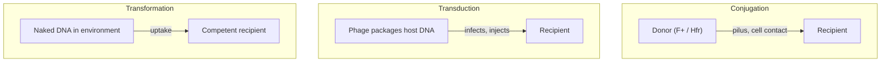
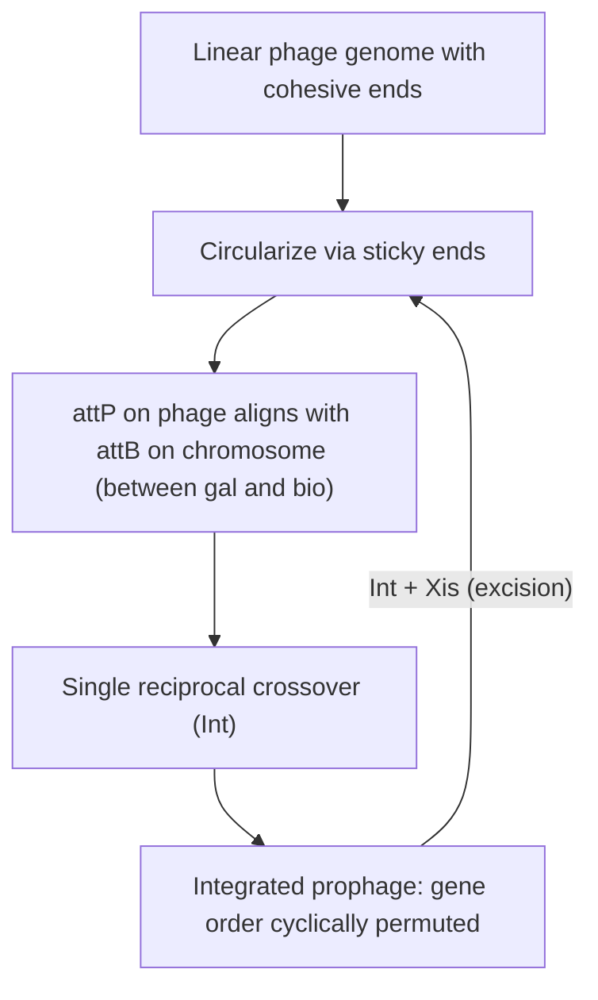
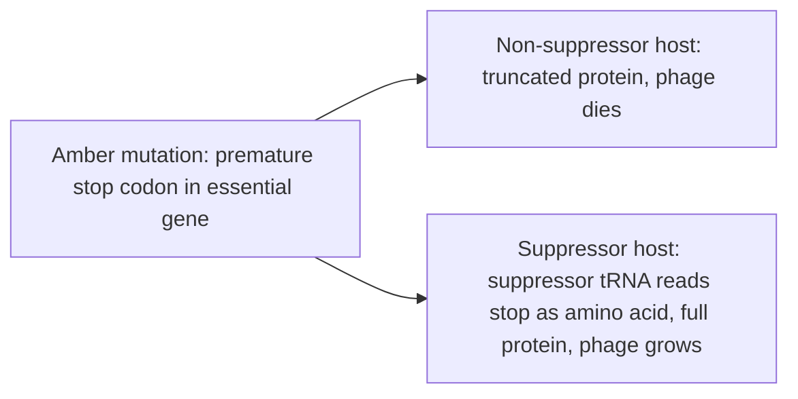
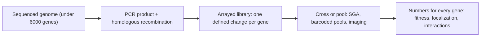
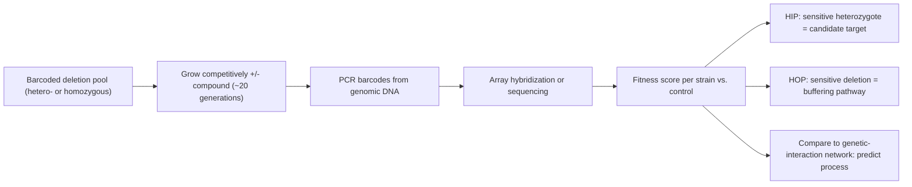
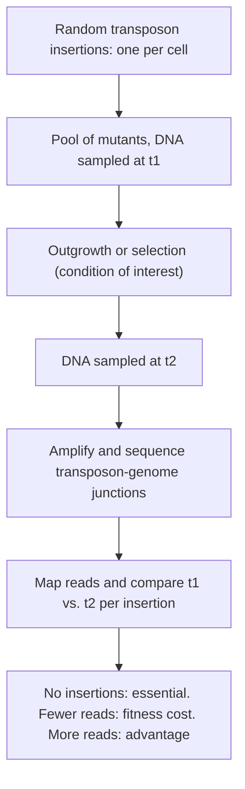
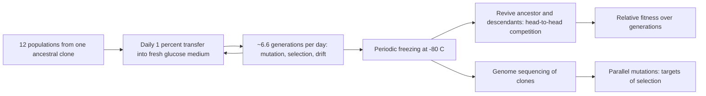

# 유전 모델 — 세균과 곰팡이 (E. coli와 효모)

**강의:** BME333 / BIO333 유전학 (UNIST, 2026 가을) · 강의 17 · 약 60분
**강의계획서:** [← 강의계획서](../../lectures/2026.BME333-BIO333-Syllabus.md) — 11주차 월, 2026-11-09
**언어:** [English](../../en/lectures/lec17_Model-Ecoli-Bacteria.md) · 한국어

## 학습 목표
이 강의를 마치면 다음을 할 수 있어야 한다:
- *E. coli*와 그 파지(phage)가 왜 분자유전학의 일꾼(workhorse)이 되었는지 설명한다(빠른 성장, 반수체 유전체, 쉬운 선택).
- 세균에서의 수평적 유전자 전달(horizontal gene transfer)의 세 가지 방식 — 접합(conjugation), 형질도입(transduction), 형질전환(transformation) — 을 구분한다.
- 접합과 중단 교배 지도작성(interrupted-mating mapping)이 어떻게 원형 *E. coli* 염색체를 밝혔는지 기술한다.
- 용원성(lysogeny)과 부위 특이적 프로파지 삽입(Campbell 모델), 그리고 파지 유전학이 어떻게 유전자의 미세 구조(fine structure)를 확립했는지 설명한다.
- 유전체 규모의 효모 계통 라이브러리(결실 컬렉션, GFP/TAP 태그 라이브러리, 조건적 대립유전자)를 기술하고, 이것이 어떻게 효모를 "모든 돌연변이체를 만들고 모든 것을 측정하는" 체계적 모델로 바꾸었는지 설명한다.
- 효모에서의 화학유전체학(chemogenomic) 프로파일링을 설명한다. 반수 불충분성 프로파일링(haploinsufficiency profiling, HIP)과 동형접합 프로파일링(homozygous profiling, HOP)이 유전자 용량(gene dosage)을 이용해 약물의 표적을 찾는 방법, 그리고 각 검정이 알려 줄 수 있는 것과 없는 것을 설명한다.
- 세균의 표현형 지형(phenotypic landscape)(수백 가지 조건에서 스크리닝한 Keio 컬렉션)과 트랜스포존 삽입 시퀀싱(transposon-insertion sequencing; Tn-seq, dual Tn-seq)이 유전자 적응도와 유전적 상호작용을 어떻게 측정하는지 기술한다.
- 실험 진화(experimental evolution)(*E. coli* 장기 진화 실험, LTEE)가 무엇을 측정하는지 설명하고, 고전 세균유전학을 현대 유전체 공학 및 "현대 종합설 속의 미생물" 관점과 연결한다.

## 강의

## Part I — 고전 세균유전학 (~34분)

### 1. 왜 세균인가? 미생물 모델의 부상 (~5분)

20세기 전반부 동안 유전학이란 식물, 파리, 생쥐를 뜻했다. 세균은 멘델적 의미의 유전자가 전혀 없다고 여겨졌다 — 보이는 염색체도 없고, 성(sex)도 없으며, 교배도 없다. 그 견해는 1940년대에 무너졌고, 이후 세균은 거의 이상적인 실험적 패키지를 제공하기에 분자유전학을 장악했다. **세대 시간(generation time)**은 분 단위이며(*E. coli* 배양은 약 20분마다 두 배가 된다), 그래서 하룻밤 사이에 *수십억* 개체를 키울 수 있다. 세균은 단일 염색체를 가진 **반수체(haploid)**이므로, 열성 돌연변이가 즉시 표현형을 나타낸다. 화학적으로 **정의된 배지(defined media)**에서 자라므로, 특정 대사 능력을 요구할 수 있다. 그리고 가장 강력하게는 **선택(selection)**을 허용한다. 즉, 드문 변이체만 생존할 수 있는 배지에 10⁹개의 세포를 도말하면 그 십억 분의 일 세포를 콜로니로 회수한다 — 백만 분의 일 또는 그보다 드문 빈도의 사건은 파리 교배에서는 전혀 보이지 않는다.

또한 개념적 장애물도 있었다. **현대 종합설(Modern Synthesis)**이 유성, 이배체 집단을 중심으로 세운 이론에 미생물이 애초에 속하기는 하는가? Novick과 Doolittle은 종합설의 설계자들(Dobzhansky, Huxley)이 **미생물을 종종 명시적으로 배제**했으며, 측면 유전자 전달(lateral gene transfer)은 나중에 종합설을 "위협하는(jeopardizing)" 것으로 규정되었다고 지적한다(참조 [en](../../en/review/Novick2019_PLoSGenet_MicrobesModernSynthesis.md) · [ko](../../ko/review/Novick2019_PLoSGenet_MicrobesModernSynthesis.md)). 그들의 해법은 진화 이론을 **설명적 자원의 도구상자(toolkit of explanatory resources)**로 다루는 것이다. 즉, 미생물은 **도구상자를 확장하는 동시에 종합설의 원래 주장의 제한된 범위를 명확히 한다**. 세균유전학은 단지 사실을 더한 것이 아니라 개념들(종, 유전자, 유전)이 재구성되도록 강제했다.

**그림 — 왜 세균이 고해상도 유전학에 이상적인가.**

| 특징 | 유전학적 결과 |
|---|---|
| 약 20분의 세대 시간 | 하룻밤에 수십억 세포; 드문 사건이 관찰 가능해짐 |
| 반수체 단일 염색체 | 열성 돌연변이가 즉시 표현형을 나타냄 |
| 정의된 최소 배지 | 특정 대사 능력을 요구할 수 있음 |
| 강력한 선택 | 10⁶–10⁹ 중 재조합체/돌연변이체 하나를 콜로니로 회수 |
| 채점 가능한 표지 | 영양요구성(auxotrophy), 파지 저항성, 당 발효(색), 항생제 저항성 |

### 2. 돌연변이는 자발적이다: 요동과 기존재 변이체 (~5분)

세균이 *유전적* 모델이 되기 전에, 세균 변이가 유전적임을 증명해야 했다. 파지를 감수성 배양에 넣으면 거의 모든 세포가 용해되지만 소수의 저항성 생존자가 자라난다. 두 가설이 경쟁했다. **획득 면역(acquired immunity, 라마르크식)**은 파지와의 접촉이 저항성을 *유도*한다는 것이고, **돌연변이(mutation, 다윈식)**는 드문 저항성 돌연변이체가 노출 **이전에** 생겨났고 파지는 단지 그들을 **선택**할 뿐이라는 것이다(참조 [en](../../en/article/LuriaDelbruck1943_Genetics_VirusResistance.md) · [ko](../../ko/article/LuriaDelbruck1943_Genetics_VirusResistance.md)).

Luria와 Delbrück(1943)은 **요동 검정(fluctuation test)**으로 둘을 구별했다. 시점(timing)이 *분산(variance)*을 예측한다. 저항성이 도말 시점에 유도된다면, 모든 배양은 독립적으로 생존자를 배출하므로 **푸아송(Poisson)** 분포(분산 ≈ 평균)를 준다. 저항성이 성장 *동안* 자발적 돌연변이로 생겨난다면, 일찍 일어난 돌연변이가 커다란 "**대박(jackpot)**" 클론을 세우므로, 병렬 배양 간의 계수는 **격심하게 요동친다(분산 ≫ 평균)**. 실험 16에서 평균은 저항성 세포 11.35개였지만, **20개 배양 중 11개는 0개**였고 **3개는 35–107개**였다 — 푸아송 하에서는 불가능한 일이다. 열 개의 실험에 걸쳐 저항성으로의 돌연변이율은 세균 한 마리, 한 분열당 평균 **2.45 × 10⁻⁸**이었다. 이것이 **선택은 변이를 만들어 내는 것이 아니라 기존재하는 변이를 드러낸다**는 것의 창시적 증명이며, 항생제 저항성에 대한 우리 이해의 미생물 조상이다.

**그림 — 요동 검정의 논리.**

| | 획득 면역 (라마르크) | 자발적 돌연변이 (다윈) |
|---|---|---|
| 저항성은 언제 생겨나는가? | 파지 노출 시점에 | 노출 이전, 앞선 성장 동안 |
| 병렬 배양 간 분포 | 푸아송 (분산 ≈ 평균) | 크게 치우침, "대박" (분산 ≫ 평균) |
| Luria–Delbrück 결과 | 기각됨 | **지지됨** (실험 16: 평균 11.35, 그러나 다수의 0과 소수의 100+) |

돌연변이가 **적응도에 대해 무작위(random with respect to fitness)**라는 원리는 철저히 감시된다. Cairns와 동료들이 "지향적(directed)" 혹은 **적응적 돌연변이(adaptive mutation)**를 주장했을 때, Franklin Stahl의 *Unicorns Revisited*는 이 분야가 그런 주장을 다루는 방식을 보여 주었다. 묵살하는 것이 아니라 후보 기전을 하나씩 검증하고 해체하는 것, 여기에는 주목할 만한 정직함으로 **자기 자신의** 기전까지 포함된다(참조 [en](../../en/review/Stahl1992_Genetics_UnicornsRevisited.md) · [ko](../../ko/review/Stahl1992_Genetics_UnicornsRevisited.md)). 이 사건은 결국 스트레스 유도 돌연변이 생성(stress-induced mutagenesis)과 유전자 증폭으로 설명되었다 — *어느* 돌연변이가 일어나는지를 "지향"하지 않으면서 돌연변이 *율(rate)*을 조절하는 기전이다.

### 3. 접합과 염색체 지도작성 (~8분)

세균은 감수분열이 없지만, 세 경로의 **수평적(측면) 유전자 전달(horizontal/lateral gene transfer)**로 유전자를 교환한다. **접합(conjugation)**에서는 DNA가 **직접 세포 접촉**(선모/짝짓기 다리)을 통해 공여자(donor)에서 수용자(recipient)로 넘어간다. **형질도입(transduction)**에서는 **박테리오파지(bacteriophage)**가 우연히 숙주 DNA를 포장하여 새 세포에 주입한다. **형질전환(transformation)**에서는 세포가 환경에서 **벌거벗은 DNA(naked DNA)**를 흡수한다. 진단적 차이 — 접촉 의존적 대 여과 가능(filterable) 대 DNase 민감 — 는 바로 고전적 실험들이 이용한 것이다.

**그림 — 세균에서의 수평적 유전자 전달의 세 가지 방식.**

Joshua Lederberg(Tatum과 함께, 1946)는 두 개의 **영양요구성(auxotrophic)** *E. coli* K-12 계통을 섞어 최소 배지에 도말함으로써 접합을 발견했다. 드문 **원영양성 재조합체(prototrophic recombinant)**가 약 백만 분의 일로 나타났고, 이중으로 표지된 부모는 단순한 복귀돌연변이(reversion)를 배제했다(참조 [en](../../en/review/Lederberg1987_Genetics_EcoliRecombination.md) · [ko](../../ko/review/Lederberg1987_Genetics_EcoliRecombination.md)). 회의론자들(특히 Delbrück)은 인공산물을 의심했으므로, Lederberg는 파지 T1 저항성을 포함한 **선택하지 않은 표지(unselected markers)**가 재조합체 중에서 안정한 부류로 깔끔하게 분리(segregate)됨을 보였다 — 이는 세포 혼합물이나 이핵체(heterokaryon)로는 만들어 낼 수 없는 일이다. 공동분리(co-segregation)가 **단일 연관군(single linkage group)**을 암시하는 여덟 개의 표지를 축적하여, 그는 *E. coli*의 첫 유전자 지도를 그렸다.

그러나 그 지도는 어긋났다. Lederberg의 1951년 "분지형(branched)" 지도는 잘못되게도 문자 그대로 받아들여졌다(Watson과 Hayes는 심지어 세 개의 염색체를 제안했다). 해결은 전달의 기전에서 왔다. **Hfr**("high frequency of recombination") 공여자는 **F 임성 인자(F fertility factor)가 염색체에 통합된** 채 지니며, Hfr는 자신의 염색체를 **고정된 기점(origin)에서 시작하여 항상 같은 방향으로**, 약 100분에 걸쳐 한 번에 하나의 유전자씩 **선형으로** 주입한다. Wollman과 Jacob의 **중단 교배(interrupted-mating)** 실험이 이를 눈에 보이게 만들었다. 그들은 Hfr × F⁻ 교배가 진행되도록 두었다가, 연속된 시점에 **믹서기(blender)**로 배양을 휘저어 짝짓기 다리를 끊고, 어느 공여자 표지가 들어왔는지 채점했다. **유전자는 시간의 함수로 나타난다** — 유전자가 일찍 들어올수록 기점에 더 가깝다 — 그래서 *시간이 곧 거리*다(분 단위). 서로 다른 Hfr 계통은 F가 서로 다른 부위와 방향으로 통합되어 있으므로 각각 다른 선형 순서를 주지만, **모든 순서가 하나의 원과 일치한다**. 이것이 **원형 *E. coli* 염색체**다.

**그림 — 중단 교배는 염색체를 분 단위로 지도화하고 원을 드러낸다.**

### 4. 형질도입: 파지 매개 유전자 전달 (~6분)

Lederberg 연구실의 22세 연구원이던 Norton Zinder는 *Salmonella typhimurium*에서 접합을 찾으려다 대신 **세 번째** 전달 방식을 발견했다(참조 [en](../../en/review/Zinder1992_Genetics_BacterialTransduction.md) · [ko](../../ko/review/Zinder1992_Genetics_BacterialTransduction.md)). LT-2 × LT-22 계통을 교배하자(1950년 10월 5일) 원영양체(prototroph)가 높은 빈도로 나타났지만, 그 현상은 **비대칭적(asymmetric)**이었고, 한 번에 **한 표지만** 옮겼으며, **세포 접촉이 필요 없었다**. Zinder는 Bernard Davis의 **U-관(U-tube)** 실험 — *E. coli* 접합에서는 여과 가능한 인자를 *배제*했던 — 을 적용하여, 세포는 막고 분자와 작은 입자는 통과시키는 **소결 유리 필터(sintered-glass filter)**로 두 계통을 분리했다. *Salmonella*에서는 전달이 **여전히 필터를 넘어 일어났다**. **여과 가능한 인자**가 작용하고 있었는데, LT-22가 지닌 **온건성 파지(temperate phage)**(P22)로, 숙주 유전자를 포장하여 LT-2로 나를 수 있었다. Lederberg는 이 과정을 **형질도입(transduction)**이라 명명했다.

**일반 형질도입(generalized transduction)**에서는 파지가 이따금 숙주 DNA의 **어떤** 단편이든 잘못 포장하므로, 두 유전자는 하나의 파지 머리에 들어갈 만큼 충분히 가까이 있을 때만 **공동형질도입(cotransduced)**된다. 공동형질도입 빈도가 단거리 연관을 측정한다. **특수 형질도입(specialized transduction)**에서는 **특정 부위**에 통합된 파지(다음 절의 λ 같은)가 부정확하게 절제(excise)될 때 **인접한** 유전자만 잘못 포장한다(예: λ가 *gal* 또는 *bio*를 집어 올림). Zinder의 대조 실험은 형질도입이 **파지에 포장된 세균 유전 물질**의 진정한 전달임을 확립했다. 그것도 Hershey–Chase와 Watson–Crick *이전에*.

**그림 — 일반 형질도입 대 특수 형질도입.**

| | 일반 (Generalized) | 특수 (Specialized) |
|---|---|---|
| 전달되는 유전자 | 숙주 유전체의 임의 영역 | 프로파지 부위에 인접한 유전자만 (예: *gal*, *bio*) |
| 형질도입 DNA의 기원 | 숙주 DNA의 무작위 오포장(mispackaging) | 통합된 프로파지의 비정상 절제 |
| 파지 유형 | 흔히 용균성(lytic) (예: P22, P1) | 온건성, 부위 특이적 (예: λ) |
| 유전학적 용도 | 단거리 공동형질도입 지도작성 | 특정 유전자좌 이동/증폭 |

### 5. 용원성과 프로파지 통합 (~6분)

**λ** 같은 **온건성(temperate)** 파지는 감염 시 선택에 직면한다. 복제하여 세포를 터뜨리거나(**용균, lytic 주기**), 숙주 염색체에 통합되어 그것과 함께 복제되는 것(**용원성, lysogeny**)이다. 후자에서는 스트레스 신호가 절제와 용해를 촉발할 때까지 **프로파지(prophage)**로서 휴면 상태로 있다. 선형 파지 유전체는 어떻게 세균 염색체에 스스로 삽입되는가? Allan Campbell의 1961년 모델은 어떤 물리적 증거도 있기 전에, 순수한 유전학적 논리로 이에 답했다(참조 [en](../../en/review/Campbell1993_Genetics_ProphageInsertion.md) · [ko](../../ko/review/Campbell1993_Genetics_ProphageInsertion.md)).

**Campbell 모델**은 두 단계로 이루어진다. 첫째, 선형 λ 유전체가 상보적 단일가닥 **점착성("끈끈한") 말단(cohesive/"sticky" ends)**을 이어 붙여 **환형화(circularize)**한다. 둘째, 파지 부착 부위(**attP**)와 상동인 염색체 부위(**attB**, *gal*과 *bio* 오페론 사이)의 **단일 상호 교차(single reciprocal crossover)**가 원 전체를 염색체에 삽입한다. 삽입이 원을 *attP*에서 열기 때문에, 이 모델은 **통합된 프로파지의 유전자 순서가 자유 파지에서의 순서의 순환 치환(cyclic permutation)**이 될 것이라고 예측했고, 바로 그것을 관찰한 것이 첫 개가였다. **Int**(integrase)는 삽입에 충분하지만, 절제는 숙주 인자와 함께 **Int에 더해 Xis**(excisionase)를 요구한다 — 이 비대칭성이 세포로 하여금 반응의 방향, 따라서 용원성/용해 결정을 제어하게 한다.

**그림 — λ 프로파지 통합의 Campbell 모델.**

중요성은 λ보다 더 깊다. 유전학은 제한효소 지도작성과 시퀀싱이 가능해지기 전에 "염색체는 **단일 연속 분자**"라고 답했다. λ 통합은 **최초로 잘 특성화된 계획된 DNA 재배열(programmed DNA rearrangement)**이 되었고, **유전자 재배열이 면역글로불린 다양성을 생성한다(V(D)J 재조합)**는 (옳은) 아이디어에 영감을 주었으며, Int는 이제 유전공학(예: Gateway 클로닝)에 쓰이는 커다란 **부위 특이적 재조합효소(site-specific recombinase, integrase) 계열**의 창시 구성원이다.

### 6. 파지 유전학과 유전자의 미세 구조 (~4분)

파지는 그 방대한 자손 수가 *단일 유전자* 내의 드문 재조합체를 검출하게 해 주었기에 유전학에 최고의 해상도를 주었다. 핵심 도구는 한 조건에서는 치사이지만 다른 조건에서는 아닌 **조건적 치사 돌연변이(conditional-lethal mutation)**, 즉 **온도 민감성(temperature-sensitive, ts)** 돌연변이체와 **앰버(amber, 넌센스) 돌연변이체**였다. 1959–1963년 Epstein, Edgar와 동료들이 발견한 **파지 T4의 앰버 돌연변이체**는 조기 **사슬 종결 코돈(chain-termination codon)**을 지닌다. 이들은 (정지 코돈을 아미노산으로 읽는) **억제자 tRNA(suppressor tRNA)**를 지닌 "허용적(permissive)" 숙주에서는 자라지만 비억제 숙주에서는 자라지 못한다 — 어떤 필수 유전자에 대해서도 깔끔한 켜짐/꺼짐 검정이다(참조 [en](../../en/review/Stahl1995_Genetics_AmberMutants-PhageT4.md) · [ko](../../ko/review/Stahl1995_Genetics_AmberMutants-PhageT4.md)). 상보성(complementation)은 약 **스무 개의 유전자**를 드러냈고(Delbrück: "얼마나 시시한가!"), 그러나 Epstein은 이 일반적 표지들이 파지의 **완전한 발생 분석(complete developmental analysis)**을 다루기 쉽게 만든다는 것을 알아보았다. 앰버 돌연변이체는 **T4 연관 지도의 원형성**을 입증했고, **기능적 군집화**를 드러냈으며, Sarabhai 등(1964)과 함께 **유전자와 폴리펩티드의 공선성(colinearity)**을 증명했다. T4 **rII** 영역에 대한 Benzer의 미세 구조 해부와 나란히, 이는 유전자를 나눌 수 있는 선형의 돌연변이 가능 부위 배열로 재정의했다.

**그림 — 앰버(넌센스) 돌연변이가 어떻게 조건적 치사 표현형을 주는가.**

세균유전학은 심지어 **행동(behavior)**도 유전적으로 해부 가능함을 보였다. Adler와 Parkinson은 *E. coli* **주화성(chemotaxis)** 돌연변이체를 분리하여, 감각 신호전달을 돌연변이로 재구성할 수 있는 경로로 다루었다(참조 [en](../../en/review/Parkinson1987_Genetics_BehavioralGenetics-Bacteria.md) · [ko](../../ko/review/Parkinson1987_Genetics_BehavioralGenetics-Bacteria.md)). 그리고 동일한 선택-및-재조합 논리는 현재로 확장된다. IS 요소와 전위(transposition)(Shapiro의 "자연적 유전공학(natural genetic engineering)", 유전체 편집의 선구자)에서부터 설계 유전체에 이르기까지, *E. coli*는 유전체를 *읽고 다시 쓰는* 곳으로 남아 있다(참조 [en](../../en/review/Shapiro2009_Genetics_Perspective-Ecoli-GenomeEng.md) · [ko](../../ko/review/Shapiro2009_Genetics_Perspective-Ecoli-GenomeEng.md)). 강의 후반부는 그 이야기를 이어 간다.

## Part II — 미생물의 현대 기능유전체학 (~26분)

고전 유전학은 **정방향(forward)**으로 작동했다. 흥미로운 표현형을 가진 돌연변이체를 찾고 그것을 유전자로 추적하는 것이다. 유전체가 시퀀싱되자 질문이 뒤집혔다 — *모든* 돌연변이체를 만들 수 있다면, 각각은 무엇을 하는가? 효모와 *E. coli*는 이것이 일상적이고 체계적인 사업이 된 두 생물이며, 이 후반부를 관통하는 생각은 **잘 정의된 하나의 돌연변이체 컬렉션을 여러 조건에서 측정하면 유전형–표현형 관계가 수치 데이터셋이 된다**는 것이다.

### 7. 효모: 진핵 미생물과 유전체 규모 라이브러리 (~6분)

*Saccharomyces cerevisiae*는 1절의 미생물 패키지 — 빠른 성장(Simon과 Bedalov에 따르면 약 90분의 배가 시간), 저렴한 배지, 쉬운 유전학 — 를 **진핵** 세포에서 제공하며, 반수체와 이배체 형태를 모두 지닌다(컬렉션에는 MATa, MATα, 이배체 계통이 모두 존재한다). Baruch, Schuldiner, Klein은 2026년 개관에서 효모가 **체계적 계통 라이브러리**의 본거지가 된 두 가지 이유를 든다. 효모는 **최초로 시퀀싱된 진핵생물**(단백질 암호화 유전자 6,000개 미만)이고, 효율적인 **PCR 매개 상동 재조합**을 가져서, 짧은 상동 팔(homology arm)을 가진 PCR 산물을 제공하면 정의된 변형을 어떤 유전자에든 표적화할 수 있다는 것이다(참조 [en](../../en/review/Baruch2026_FEBSJ_YeastLibraries-Overview.md) · [ko](../../ko/review/Baruch2026_FEBSJ_YeastLibraries-Overview.md)). 라이브러리는 각 돌연변이체를 유전자로 추적해야 했던 수고로운 무작위 돌연변이 유발 스크리닝을 대체했고, 약 15,000편의 논문에서 인용된다. 더 깊은 가치는 모든 유전자를 **하나의 체계적 실험**에서 비교하여 기능적 관계와 네트워크의 수치적 척도를 얻는다는 점이다.

1세대 컬렉션이 틀을 세웠다. **효모 녹아웃(YKO) 라이브러리**는 각 유전자를 결실시키고 분자 **바코드(barcode)**(UPTAG/DNTAG)를 붙여 계통들을 풀링하고 계수할 수 있게 한다. 반수체와 이배체 형태가 있으며, **필수 유전자(essential genes)**(풍부한 포도당 배지에서 1,105개)는 이형접합체로 연구된다. **C-말단 GFP 라이브러리**는 고유 프로모터에서 각 단백질의 살아 있는 세포 내 위치를 보고하고, **TAP 태그 라이브러리**는 단백질체의 약 80%가 풍부한 배지에서 발현되며 수준이 세포당 50분자 미만에서 1,000,000분자 초과에 이름을 보였다. 결실 컬렉션은 또한 유전적 상호작용의 **합성 유전자 배열(synthetic genetic array, SGA)** 분석을 가능하게 했고, SGA는 어떤 라이브러리든 공여자와 교배하여 맞춤 컬렉션(예: 모든 결실 배경에서의 태그된 단백질)을 만들 수 있게 한다. 리뷰의 Table 1은 약 5,120개의 결실 유전자, 5,206개의 GFP 융합, 4,715개의 TAP 융합을 나열한다. 이후 세대가 빈틈을 메웠다. 필수 유전자는 억제 가능한 프로모터, 온도 민감성 대립유전자(허용 25 °C, 제한 32–37 °C), DAmP 저형질(hypomorph)(3′ UTR 교체로 전사체를 2–10배 낮춤), 그리고 단백질을 필요할 때 고갈시켜 보상적 적응을 피하는 **옥신 유도 디그론(auxin-inducible degron)**으로 연구할 수 있다. **SWAT** 플랫폼은 하나의 라이브러리 안에서 태그와 프로모터를 교체할 수 있게 한다. 저자들은 또한 웰 간 오염과 이차 또는 억제 돌연변이를 경고하며, PCR이나 시퀀싱으로 계통을 검증할 것을 권한다.

**그림 — 유전체 규모 효모 라이브러리와 각각이 측정하는 것.**

| 라이브러리 | 모든 유전자에서 변형되는 것 | 전형적 판독 |
|---|---|---|
| YKO 결실 (바코드) | 유전자 결실 (필수 유전자는 이형접합체로) | 풀링 성장에서의 적응도; SGA 유전적 상호작용 |
| GFP 융합 (C-말단) | 고유 프로모터 하에서 단백질 태그 | 세포 내 위치 |
| TAP 태그 | 친화성 태그 | 존재량(단백질체의 약 80% 발현), 복합체, 반감기 |
| 억제/유도 프로모터, ts, DAmP | 필수 유전자의 발현 또는 활성을 낮춤 | 필수 유전자의 고갈 표현형 |
| 옥신 유도 디그론 (AID) | 필요 시 단백질 분해 | 장기 보상 없는 급성 기능 상실 |
| SWAT | 하나의 라이브러리에서 태그 또는 프로모터 교체 가능 | 단일 모체에서 만드는 맞춤 라이브러리 |

**그림 — 유전체 서열에서 체계적 표현형 지도로.**

### 8. 화학유전체학: 약물이 무엇을 건드리는지 찾기 (~7분)

여기서 효모 결실 컬렉션이 약리학을 만난다. Bredel과 Jacoby는 문제를 이렇게 규정한다. 약리학적 화합물이 50년에 걸쳐 약 400–500개 유전자의 산물에 작용하는 것으로 밝혀졌지만, 시판 약물의 표적은 약 120개에 불과한 반면, 인간 유전체 프로젝트는 약물 감수성 유전자가 수천 개일 것을 시사했다(참조 [en](../../en/review/Bredel2004_NatRevGenet_Chemogenomics.md) · [ko](../../ko/review/Bredel2004_NatRevGenet_Chemogenomics.md)). 그들은 화학유전체학을 고전 유전학의 논리로 분류한다. **역방향(reverse)**(정제된 표적에서 출발해 화합물을 스크리닝)과 **정방향(forward)**(세포나 생물의 표현형에서 출발해 활성 화합물의 표적을 찾음)이다. Jones와 Bunnage는 제약 산업의 관점을 더한다. 대부분의 임상 탈락은 효능 부족이고, 표현형 스크리닝은 표적이 알려지지 않은 채로 히트를 내며, 잘 주석된 선택적 화합물의 **화학유전체 라이브러리(chemogenomic library)**는 표현형 히트를 표적 가설로 바꿀 수 있다(참조 [en](../../en/review/Jones2017_NatRevDrugDiscov_ChemogenomicLibraryScreening.md) · [ko](../../ko/review/Jones2017_NatRevDrugDiscov_ChemogenomicLibraryScreening.md)). 효모는 같은 목표에 이르는 유전학적 경로를 제공한다.

핵심 아이디어는 **유전자 용량(gene dosage)**이다. Giaever 등(1999)은 한 유전자의 사본을 둘이 아닌 하나만 가진 이형접합 이배체 효모가 그 유전자 산물을 억제하는 약물에 과민해짐을 보였다 — **약물 유도 반수 불충분성(drug-induced haploinsufficiency)**(참조 [en](../../en/article/Giaever1999_NatGenet_InducedHaploinsufficiency.md) · [ko](../../ko/article/Giaever1999_NatGenet_InducedHaploinsufficiency.md)). 여섯 개의 알려진 표적(*HIS3*, *ALG7*, *RNR2*, *TUB1/TUB2*, *ERG11*)에 대한 이형접합체는 각각 해당 약물에만 과민했고 다른 약물에는 그렇지 않았다. 예를 들어 *alg7/ALG7*은 야생형이 정상적으로 자라는 0.5 µg/ml 튜니카마이신(tunicamycin)에서 억제되었다. 이어 그들은 고유한 20염기 **바코드**를 지닌 계통을 풀링하여 약물 유무 하에서 경쟁적으로 키우고, PCR과 어레이 혼성화로 존재량을 읽었다. 233개 계통 풀에서 튜니카마이신에 민감한 계통은 셋뿐이었다. *alg7/ALG7*(알려진 표적)과, 동형접합 결실도 민감했기에 표적이 아니라 "과민성(hypersensitivity)" 유전자좌인 다른 둘이다. Giaever 등(2004)은 이를 약 6,000개 이형접합 계통 전체 컬렉션(5,918개 분석), 풀링 성장 약 20세대, 10개 화합물로 80회의 전 유전체 실험으로 확장했다(참조 [en](../../en/article/Giaever2004_PNAS_ChemogenomicProfiling.md) · [ko](../../ko/article/Giaever2004_PNAS_ChemogenomicProfiling.md)). 메토트렉세이트(methotrexate)는 아홉 번의 반복 중 여덟 번에서 알려진 표적 *DFR1*과 상위 엽산 합성 유전자(*FOL1*, *FOL2*)를 확인했다. 반면 5-플루오로우라실(5-fluorouracil)은 티미딜산 합성효소(thymidylate synthase)를 점수화하지 *않았다*. 그 민감 유전자 22개는 rRNA 가공과 리보솜 생합성에 농축되어(P ≈ 4 × 10⁻⁹), 효모에서 주된 성장 억제 기전이 RNA 오삽입임을 가리켰다. 시스플라틴(cisplatin)은 이형접합 히트가 없었지만, **동형접합** 풀은 DNA 수선 유전자를 드러냈다. 이 검정은 두 부류의 유전자를 찾는다. 용량 제한적인 직접 상호작용자와, 약물 가용성(수송, 배출, 대사)에 영향을 주는 유전자이며, 높은 약물 용량에서는 표적 특이성이 사라진다.

Smith, Ammar, Nislow, Giaever의 2010년 개관은 바코드 컬렉션 위에 세워진 도구 전체를 제시한다(참조 [en](../../en/review/Smith2010_PharmacolTher_YeastChemicalGenomicAssays.md) · [ko](../../ko/review/Smith2010_PharmacolTher_YeastChemicalGenomicAssays.md)). **HIP**은 이형접합 이배체를 스크리닝하며 종종 표적을 직접 지목한다 — 2,000개 이상의 화합물을 스크리닝하는 동안 HIP이 잘 특성화된 성장 제한 표적을 식별하지 못한 적은 아직 없었다. **HOP**은 비필수 유전자의 완전 결실을 사용한다. 표적이 없으므로 HOP은 대신 표적 경로를 **완충(buffer)**하는 유전자(예: DNA 손상제에 대한 DNA 수선 모듈)를 드러낸다. **다복제 억제 프로파일링(multi-copy suppression profiling)**은 과발현에 의한 저항성을 찾고, 비교 발현 프로파일링은 약물 유도 전사체 프로파일을 돌연변이체 프로파일과 맞춘다. 한계로는 효모에 없는 표적, 중복 표적, 세포벽과 배출 펌프 때문에 필요한 높은 화합물 농도가 있다. Simon과 Bedalov는 투과성 문제를 극복하고 효모를 항암제 발굴에 쓰는 방법을 보인다. 100,000개 이상 화합물의 NCI 스크린에서 *ERG6*와 *PDR1/PDR3*가 결여된 계통은 화합물의 약 25%에서 성장 억제가 10배 넘게 증가했고, 6,000개 NCI 화합물의 경로 스크린에서 텔로미어 근접 *URA3* 리포터가 **스플리토마이신(splitomicin)**을 Sir2 억제제로 식별했으며, 그 발현 프로파일은 *sir2* 돌연변이체와 일치했다(참조 [en](../../en/review/Simon2004_NatRevCancer_YeastAnticancerDrugDiscovery.md) · [ko](../../ko/review/Simon2004_NatRevCancer_YeastAnticancerDrugDiscovery.md)).

**그림 — HIP 대 HOP: 각 화학유전체 검정이 보고하는 것.**

| | HIP (반수 불충분성 프로파일링) | HOP (동형접합 프로파일링) |
|---|---|---|
| 스크리닝하는 계통 | 이형접합 이배체 결실 (필수 및 비필수 유전자) | 비필수 유전자의 완전 결실 |
| 표적의 유전자 용량 | 절반 (사본 하나) | 0 (표적 유전자 없음) |
| 가장 민감한 계통은 대체로 | 약물 표적 (또는 속도 제한 경로 단계) | 완충 또는 보상 유전자 (예: DNA 수선) |
| 전형적 예 | 메토트렉세이트의 *DFR1*; 튜니카마이신의 *ALG7* | 시스플라틴의 DNA 수선 유전자 |
| 주요 단서 | 중복, 비필수 또는 비효모 표적을 놓침; 약물 가용성 유전자도 점수화됨 | 표적 자체는 직접 드러나지 않음 |

현대 플랫폼은 마이크로어레이를 시퀀싱으로 바꾸고 네트워크 해석을 더한다. Piotrowski 등(2017)은 **약물 감작 배경(drug-sensitized background)**(*pdr1 pdr3 snq2*, 성장 억제 화합물 수를 약 5배 늘리며, 13,524개 화합물에 걸쳐 평균 히트율 약 35%), 효모 유전적 상호작용 네트워크의 17개 주요 생물학적 과정을 포괄하는 **310개 결실 돌연변이체**의 진단 풀, 그리고 768-플렉스 바코드 시퀀싱 프로토콜을 구축했다. 각 화학유전체 프로파일을 전 유전체 유전적 상호작용 프로파일과 비교하여 화합물이 교란하는 과정을 예측했고, 일곱 개 라이브러리에 걸쳐 1,522개의 고신뢰 프로파일을 얻었다(참조 [en](../../en/article/Piotrowski2017_NatChemBiol_ChemicalLibraryAnnotation.md) · [ko](../../ko/article/Piotrowski2017_NatChemBiol_ChemicalLibraryAnnotation.md)). 논리는 다시 상위성(epistasis)이다. 약물은 표적 경로의 돌연변이의 "표현형 모사체(phenocopy)"다. Zhou 등(2019)은 같은 파이프라인을 333,200개 화합물의 중국 국가 화합물 라이브러리에 적용했다. 5,360개 화합물(1.6%)이 성장을 억제했고, 1,109개가 고신뢰 과정 예측을 가졌으며, 그 중 78%가 적어도 하나의 승인된 약물과 닮았다. 사람 세포에서 시험한 결과, 알려진 자가포식(autophagy) 유도제와 닮을 것으로 예측된 38개 화합물 중 14개가 GFP-LC3 점(puncta)을 증가시켰고, Wnt 억제제 FH535와 닮을 것으로 예측된 한 화합물은 **효모에 없는 경로**에 작용했으며 IC50(7.44 µM)가 FH535(7.43 µM)와 일치했다(참조 [en](../../en/article/Zhou2019_ActaPharmacolSin_YeastChemicalGenomicsMammalianPathways.md) · [ko](../../ko/article/Zhou2019_ActaPharmacolSin_YeastChemicalGenomicsMammalianPathways.md)). 화학유전체학은 약물에 국한되지 않는다. Fletcher 등(2021)은 반수체 결실 배열을 80 mM 아디프산(adipic acid)(나일론-6,6의 전구체로, 효모에 독성이 있어 공학적 생산의 한계가 됨)에서 스크리닝하여 77개의 민감 돌연변이체(43개 확인)를 찾았고, 이들은 에르고스테롤 생합성과 단백질 수송(ESCRT, GARP, COG)에 농축되어 있었으며 단일 억제자로 *KGD1*이 있었다(참조 [en](../../en/article/Fletcher2021_iScience_AdipicAcidToxicity-Chemogenomics.md) · [ko](../../ko/article/Fletcher2021_iScience_AdipicAcidToxicity-Chemogenomics.md)). 마지막으로 검정이 정교할 필요는 없다. Hung 등(2018)은 일반 플레이트 리더로 **IC50**를 얻는 96-웰 액체 배양 프로토콜을 제시하고, 이 방법이 평판에서는 드러나지 않던 결함을 검출하고(*ENT3* 결실이 *chs6* 세포의 calcofluor white IC50를 약 2배 낮춘다) 시간도 줄여 준다고 보인다(*art1* 세포의 카나바닌(canavanine) 과민성 약 3배가 24시간 안에 관찰되는 반면 평판에서는 5일이 걸린다)(참조 [en](../../en/article/Hung2018_SciRep_YeastChemicalSensitivity-IC50.md) · [ko](../../ko/article/Hung2018_SciRep_YeastChemicalSensitivity-IC50.md)).

**그림 — 효모 풀링 화학유전체 스크린의 해부.**

### 9. 세균 기능유전체학: 표현형 지형과 Tn-seq (~7분)

*E. coli*에는 단일 유전자 녹아웃의 **Keio** 컬렉션이라는 자체 결실 컬렉션이 있다. 세균은 **단일 배수체(monoploid)**이므로 HIP의 이형접합체 요령을 쓸 수 없다. 대신 Pathania 등(2009)은 **다복제 억제(high-copy suppression)**를 사용했다. 필수 *E. coli* 유전자의 정렬된 배열을 과발현시키고 어느 것이 화합물 속에서 성장을 구제하는지 물은 것이다(참조 [en](../../en/article/Pathania2009_NatChemBiol_EcoliLipoproteinTargeting-MAC13243.md) · [ko](../../ko/article/Pathania2009_NatChemBiol_EcoliLipoproteinTargeting-MAC13243.md)). 알려진 항생제의 표적이 나타났고(포스포마이신–*murA*, 트리메토프림–*folA*, D-사이클로세린–*ddl* 등), 각 항생제는 자기만의 억제자 프로파일을 가졌다. 약 50,000개 분자 스크린에서 나온 새 화합물 **MAC13243**은 지질단백질 수송의 주변세포질(periplasmic) 샤페론인 **LolA**의 과발현으로 억제되었다. 이 화합물은 Braun 지질단백질이 내막에 축적되게 했고, 정제된 LolA에 직접 결합했으며(Kd = 7.5 ± 3 µM), Lol 경로가 없는 그람 양성균에는 작용하지 않고 그람 음성균에 활성이 있었다.

단일 녹아웃 아이디어의 규모 확장이 **표현형 지형(phenotypic landscape)**이다. Nichols 등(2011)은 Keio 라이브러리, 필수 유전자 저형질, 소형 RNA/단백질 녹아웃(플레이트당 1,536 콜로니로 배열)을 114가지 고유 스트레스를 포괄하는 **324개 조건**에서 스크리닝하여 3,979개 돌연변이체 × 324개 조건의 행렬을 만들었다(참조 [en](../../en/article/Nichols2011_Cell_PhenotypicLandscapeBacterialCell.md) · [ko](../../ko/article/Nichols2011_Cell_PhenotypicLandscapeBacterialCell.md)). 표현형 서명이 r = 0.6–0.8로 상관된 유전자 쌍은 같은 오페론 구성원인 경우가 100배 넘게, 알려진 단백질 상호작용은 150배 농축되었다. FDR 5%에서 계통의 49%(1,957/3,979)가 적어도 하나의 표현형을 보였고(총 13,497개 표현형, 약 80%가 음성), 197개의 조건적 필수 유전자가 식별되어 알려진 필수 유전자 수가 약 30% 늘었다. 서명은 또한 기능을 부여한다. 특성이 알려지지 않은 *marB*는 억제자 *marR*처럼 행동했고, 설폰아마이드와 트리메토프림은 강하게 상승 작용을 하면서도 프로파일 상관은 약했다(r = 0.15). Lao 등(2026)은 Keio 자원을 시간 차원으로 확장하여, LB와 M63 포도당 최소 배지에서 3,909개 녹아웃의 성장 곡선 — 생물학적 삼중 반복으로 23,454개의 궤적 — 을 공개했으며, 각각에서 수용력(carrying capacity) *K*와 최대 성장률 *r*을 추출했다(참조 [en](../../en/article/Lao2026_SciData_EcoliKeio-GrowthCurves.md) · [ko](../../ko/article/Lao2026_SciData_EcoliKeio-GrowthCurves.md)).

배열된 컬렉션은 유전자당 하나의 계통이 필요하다. **트랜스포존 삽입 시퀀싱(transposon-insertion sequencing, TIS)**은 그렇지 않다. van Opijnen, Bodi, Camilli(2009)는 **Tn-seq**를 도입했다. mariner 트랜스포존(*magellan6*, TA 이뉴클레오타이드만 필요)이 거의 무작위로 삽입되고, 풀을 키운 뒤 성장 전후의 트랜스포존–유전체 접합부를 Illumina로 시퀀싱하면 각 삽입의 적응도를 얻는다(참조 [en](../../en/article/VanOpijnen2009_NatMethods_TnSeq-FitnessGeneticInteraction.md) · [ko](../../ko/article/VanOpijnen2009_NatMethods_TnSeq-FitnessGeneticInteraction.md)). *Streptococcus pneumoniae*(TIGR4의 비피막 유도체 AC2394 균주, 약 25,000개 삽입의 라이브러리 여섯 개, 약 7세대)에서 유전자의 76%는 중립, 6%는 유리, 2%는 불리, 16%는 필수일 가능성(삽입이 회수되지 않음)이었다. 적응도는 30개 돌연변이체에 대한 고전적 경쟁 검정과 일치했다. **유전적 상호작용** — 이중 돌연변이가 단일 돌연변이들의 곱셈 기대값에서 벗어나는 것 — 을 찾기 위해 그들은 다섯 개의 질의 유전자 결실 배경에서 라이브러리를 만들어 97개의 고신뢰 상호작용을 찾았고, 주요 이화대사산물 조절자 *ccpA*가 허브(파트너 64개, 그 절반이 탄수화물 흡수 및 대사 유전자)였다. Cain 등(2020)은 TIS 10년(Tn-Seq, TraDIS, INSeq, HITS)을 리뷰한다. 작업 흐름은 포화 라이브러리, 선택적 도전, 시퀀싱과 매핑이며, 삽입이 없는 유전자는 필수 후보이고 조건에서 삽입 빈도가 떨어지는 유전자는 그곳에서의 적응도에 필요하다. 발전으로는 필수 유전자를 위한 바깥 방향 프로모터, 바코드 트랜스포존(32종 세균에 약 130~200개 조건으로 적용된 RB-Tn-Seq, 리뷰가 두 수치를 모두 제시하므로 범위로 적었다), 집단 병목에 제한되는 감염 모델이 있다(참조 [en](../../en/review/Cain2020_NatRevGenet_TIS-DecadeOfAdvances.md) · [ko](../../ko/review/Cain2020_NatRevGenet_TIS-DecadeOfAdvances.md)). 기존 Tn-seq는 "일 대 전체(one-to-all)"다. 질의 유전자를 먼저 돌연변이시켜야 한다. Zik 등(2025)은 **dual Tn-seq**로 이를 **"전체 대 전체(all-to-all)"**로 만들었다. 각각 lox 부위를 지닌 두 개의 바코드 mariner 트랜스포존의 바코드가 Cre 재조합으로 하나의 읽을 수 있는 이중 바코드로 융합되며, *S. pneumoniae* D39W에서 약 620,000개와 약 230,000개의 돌연변이 라이브러리를 교배하여 약 14억 개의 이중 돌연변이를 만들고 958,696개(73%)의 비필수 유전자 쌍을 포괄했다(참조 [en](../../en/article/Zik2025_Science_DualTnSeq-GeneticInteraction.md) · [ko](../../ko/article/Zik2025_Science_DualTnSeq-GeneticInteraction.md)). 시험한 107개 쌍 중 15개가 합성 치사였고, 이 스크린은 알려지지 않은 유전자 Spd_0310이 *pyrG*와 상호작용하며 대체 CTP 합성효소를 암호화함을 드러내어 PyrJ로 개명되었다(암모니아를 이용해 UTP에서 CTP).

**그림 — Tn-seq 작업 흐름: 무작위 삽입 풀에서 유전자 적응도로.**

**그림 — 배열 컬렉션 대 Tn-seq 풀 대 dual Tn-seq.**

| | Keio 표현형 지형 | Tn-seq | Dual Tn-seq |
|---|---|---|---|
| 출발 재료 | 배열된 단일 유전자 녹아웃 | 풀링된 무작위 삽입 | 풀링된 이중 삽입 라이브러리 |
| 노트에서의 규모 | 3,979개 돌연변이체 × 324개 조건 | 라이브러리당 약 25,000개 삽입 | 약 14억 개 이중 돌연변이 |
| 답하는 질문 | 각 유전자는 어느 조건에서 중요한가? | 유전자 적응도; 선택한 질의 유전자와의 상호작용 | 거의 모든 비필수 유전자 쌍 사이의 상호작용 |
| 노트에서의 생물 | *E. coli* K-12 | *S. pneumoniae* (TIGR4 유도체 AC2394) | *S. pneumoniae* D39W |

### 10. 미생물의 진화와 공학 (~4분)

미생물의 마지막 용도는 진화가 일어나는 것을 지켜보는 것이다. Lenski의 **장기 진화 실험(Long-Term Evolution Experiment, LTEE)**은 1988년 하나의 조상 계통에서 세운 12개의 *E. coli* 집단으로 시작했으며, 각각은 포도당 제한 최소 배지에서 1%(100배) 전이로 매일 계대되고 — 하루 약 6.6–6.7세대 — 시료는 −80 °C에서 냉동되므로, 조상과 후손을 되살려 직접 경쟁시킬 수 있다("타임머신")(참조 [en](../../en/review/Lenski2017_ISMEJ_ExperimentalEvolution-LTEE.md) · [ko](../../ko/review/Lenski2017_ISMEJ_ExperimentalEvolution-LTEE.md)). 적응도는 중립적 아라비노스 이용 표지로 구별되는 진화한 세포와 조상 세포의 직접 경쟁에서 실현된 성장률의 비, 즉 **상대 적응도(relative fitness)**로 측정된다. 적응도는 처음 2,000세대에 약 세 단계로 ~30% 상승했고, 총평균 적응도는 50,000세대에 ~1.7에 이르렀으며, 개선 속도는 둔화되지만 멱법칙(power-law) 모델에서는 상한이 없다. "단순한" 실험은 복잡성을 진화시켰다. 집단 Ara-2는 교차 급식(cross-feeding)으로 유지되는 L과 S 생태형(ecotype)으로 갈라져 안정적으로 공존했고, 여섯 집단은 과돌연변이(hypermutable, 점돌연변이율 ~100배)가 되었으며, 약 31,000세대 후 집단 Ara-3는 *citT*의 직렬 중복으로 새 프로모터 아래에 사본이 놓이면서 **시트르산(citrate)**에서의 호기적 성장을 진화시켰다. 재현 실험은 **역사적 우연성(historical contingency)**을 보였다. 조상이나 20,000세대 이전의 클론에서는 Cit+ 돌연변이체가 나타나지 않았다. 264개 클론의 시퀀싱에서 50,000세대에 비과돌연변이 클론당 약 75개의 돌연변이가 발견되었고, 57개 유전자(코딩 서열의 ~2%)가 비동의 돌연변이의 절반을 지녔다 — 선택의 표적을 나타내는 평행 진화(parallel evolution)다.

Lenski(2023)는 설계가 왜 작동하는지 다시 짚는다. 매일의 연속 계대(저렴하고 정밀하며 오염에 강함), 단일 제한 자원(빈도 의존적 선택을 최소화하기 위한 25 µg/mL 포도당), 플라스미드와 기능적 프로파지가 없고 자연 형질전환도 없는 조상(REL606; 따라서 **수평적 유전자 전달 없음**), 그리고 단일 반수체 세포에서 시작한 각 집단 — 그래서 모든 돌연변이는 독립적으로 생겼고 수렴은 진정한 **평행 진화**다(참조 [en](../../en/review/Lenski2023_JMolEvol_LTEE-Design.md) · [ko](../../ko/review/Lenski2023_JMolEvol_LTEE-Design.md)). 조상은 Luria와 Delbrück의 계통(2절)인 *E. coli* B에서 유래하며, LTEE는 그들이 보인 바로 그 자발적이고 무작위적인 돌연변이에 의존한다. Pantoja-Alonso 등(2025)은 반대 방향, 곧 무작위에서 합리적으로의 흐름을 추적한다. 적응적 실험실 진화(1951년 이후)와 UV 및 화학적 돌연변이 유발, 이어서 부위 특이적 재조합효소와 트랜스포존, 그다음 재조합공학(recombineering)(Keio 컬렉션을 낳은 Datsenko와 Wanner의 λ Red 방법), MAGE(2009), CRISPR/Cas(2012)이며, 편집 효율은 이전 기술의 10–40%에 비해 약 50–90%로 보고된다(참조 [en](../../en/review/PantojaAlonso2025_Microbiology_GenomeEngineering-BacterialProductivity.md) · [ko](../../ko/review/PantojaAlonso2025_Microbiology_GenomeEngineering-BacterialProductivity.md)). 이는 6절의 Shapiro의 "자연적 유전공학"과 고리를 닫는다(참조 [en](../../en/review/Shapiro2009_Genetics_Perspective-Ecoli-GenomeEng.md) · [ko](../../ko/review/Shapiro2009_Genetics_Perspective-Ecoli-GenomeEng.md)). 세포 자신의 재조합효소와 트랜스포존이 이제 우리가 의도적으로 겨냥하는 도구가 되었다.

**그림 — 실험 진화 루프(LTEE)와 측정되는 것.**

### 11. 마무리 및 토론 (~2분)

한 강의에서 우리는 세균 변이가 유전적임을 증명하는 것(Luria–Delbrück)에서, 시계로 염색체를 지도화하는 것(중단 교배)으로, 유전자 전달의 세 기전과 프로파지 통합 및 유전자 자체의 해부학으로 나아갔다. 그런 다음 같은 미생물이 *체계적* 도구로 바뀌는 것을 보았다. 약물의 표적을 그 용량 민감성으로 알려 주는 효모의 바코드 결실 풀, 모든 유전자에 모든 조건에서의 적응도를 부여하는 세균의 표현형 지형과 Tn-seq, 그리고 진화를 되풀이해 재생하는 35년 된 진화 실험이다. 관통하는 주제는 **강력한 선택 + 방대한 수 + 영리한 설계**가 미생물로 하여금 어떤 다세포 생물보다 정밀하게 유전학을 분해하게 했다는 것, 그리고 모든 유전자를 교란하고 계수할 수 있게 되면 유전학이 정량적이 된다는 것이다.

## 핵심 정리
- 세균은 고해상도 유전학에 이상적이다. **빠른 성장, 반수체 단일 염색체, 정의된 배지, 강력한 선택**이 백만 분의 일 사건을 보이게 만든다.
- **Luria–Delbrück 요동 검정**은 돌연변이가 **자발적이며 선택 이전에 존재함(pre-selective)**을 증명했다(대박 ⇒ 분산 ≫ 평균; 율 ~2.45 × 10⁻⁸). 항생제 저항성을 이해하는 기초다.
- 세균은 세 경로로 유전자를 교환한다: **접합**(접촉), **형질도입**(파지 매개), **형질전환**(벌거벗은 DNA).
- **Hfr** 공여자를 이용한 **중단 교배**는 유전자를 **분 단위**로 지도화한다(시간 = 거리). Hfr 계통들을 조합하면 *E. coli* 염색체가 **원형**임이 증명된다.
- **형질도입**(Zinder & Lederberg)은 일반 또는 특수형이며, **공동형질도입 빈도**가 단거리 연관을 측정한다.
- **Campbell 모델**: λ는 끈끈한 말단으로 환형화하고 **단일 교차**(attP × attB)로 삽입되어 유전자 순서를 순환 치환한다. **Int**가 통합하고 **Int+Xis**가 절제한다 — 최초의 계획된 DNA 재배열이자 V(D)J 재조합의 개념적 부모.
- 파지 T4의 **앰버(넌센스) 및 ts 조건적 치사** 돌연변이체는 원형 지도, 유전자 군집화, **유전자–단백질 공선성**을 확립하여 유전자를 뉴클레오타이드 해상도로 끌어내렸다.
- 효모 **유전체 규모 라이브러리**(바코드 결실 컬렉션, GFP/TAP 태그, 조건적 대립유전자, SGA, SWAT)는 효모가 최초로 시퀀싱된 진핵생물이고 PCR 산물을 효율적으로 재조합하기 때문에 존재하며, 모든 유전자를 하나의 실험에서 비교할 수 있게 한다.
- **HIP**은 유전자 용량을 이용한다. 약물 표적 유전자의 이형접합체는 과민하므로, 바코드 풀에서 가장 많이 고갈된 계통이 종종 표적을 지목한다. **HOP**(완전 결실)은 대신 **완충** 경로를 드러내며, 둘을 함께 쓰면 표적과 보상을 분리한다.
- 화학유전적 프로파일은 효모 **유전적 상호작용 네트워크**와 비교하여 화합물이 교란하는 생물학적 과정을 예측할 수 있으며, 그 예측은 효모에 없는 경로를 포함한 포유류 경로로 전이된다.
- 세균에서 **표현형 지형**(324개 조건의 Keio 돌연변이체)과 **Tn-seq / dual Tn-seq**는 유전자당 하나의 계통 배열 없이 전 유전체 적응도와 유전적 상호작용을 제공한다. 삽입이 없는 유전자는 필수이며, 이중 삽입 스크린은 합성 상호작용과 새 유전자 기능을 찾아낸다.
- **LTEE**는 단순하고 일정한 환경에서의 진화가 반복적(평행) 돌연변이, 감소하지만 상한 없는 적응도 증가, 시트르산 이용 같은 우연적 혁신을 낳음을 보여 준다. 유전체 공학 도구(재조합공학, MAGE, CRISPR)는 이제 우리가 변화를 의도적으로 쓰게 한다.

## 교재 참고
- **Genetics: From Genes to Genomes (8e)** — Ch. 16 Bacterial Genetics. → [textbook ref](../../lectures/ref.Genetics-FromGenesToGenomes.md)

## 이 저장소의 노트
이 강의와 함께 읽을 논문 (각각 en/ko 이중언어 쌍이 있음).

**고전 세균유전학**
- `Lederberg1987_Genetics_EcoliRecombination` — *E. coli*에서 재조합/접합을 발견한 일인칭 기록; 염색체 지도작성 이야기의 닻. · [en](../../en/review/Lederberg1987_Genetics_EcoliRecombination.md) · [ko](../../ko/review/Lederberg1987_Genetics_EcoliRecombination.md)
- `LuriaDelbruck1943_Genetics_VirusResistance` — 요동 검정; 돌연변이는 자발적이며 선택 이전에 존재한다 — 창시적 정량 실험. · [en](../../en/article/LuriaDelbruck1943_Genetics_VirusResistance.md) · [ko](../../ko/article/LuriaDelbruck1943_Genetics_VirusResistance.md)
- `Zinder1992_Genetics_BacterialTransduction` — 형질도입의 발견; 지도작성을 위한 파지 매개 유전자 전달을 소개. · [en](../../en/review/Zinder1992_Genetics_BacterialTransduction.md) · [ko](../../ko/review/Zinder1992_Genetics_BacterialTransduction.md)
- `Campbell1993_Genetics_ProphageInsertion` — 부위 특이적 프로파지 통합의 Campbell 모델; 용원성 절의 핵심. · [en](../../en/review/Campbell1993_Genetics_ProphageInsertion.md) · [ko](../../ko/review/Campbell1993_Genetics_ProphageInsertion.md)
- `Parkinson1987_Genetics_BehavioralGenetics-Bacteria` — "행동유전학"으로서의 세균 주화성; 신호전달과 행동의 모델로서의 세균을 보임. · [en](../../en/review/Parkinson1987_Genetics_BehavioralGenetics-Bacteria.md) · [ko](../../ko/review/Parkinson1987_Genetics_BehavioralGenetics-Bacteria.md)
- `Stahl1992_Genetics_UnicornsRevisited` — 파지 재조합과 유전 교배의 논리에 대한 성찰. · [en](../../en/review/Stahl1992_Genetics_UnicornsRevisited.md) · [ko](../../ko/review/Stahl1992_Genetics_UnicornsRevisited.md)
- `Stahl1995_Genetics_AmberMutants-PhageT4` — T4의 앰버(넌센스) 조건적 돌연변이체; 파지 유전학이 유전자 기능을 해부한 방법. · [en](../../en/review/Stahl1995_Genetics_AmberMutants-PhageT4.md) · [ko](../../ko/review/Stahl1995_Genetics_AmberMutants-PhageT4.md)
- `Novick2019_PLoSGenet_MicrobesModernSynthesis` — 미생물이 진화유전학에 들어온 방식에 대한 역사적/개념적 틀. · [en](../../en/review/Novick2019_PLoSGenet_MicrobesModernSynthesis.md) · [ko](../../ko/review/Novick2019_PLoSGenet_MicrobesModernSynthesis.md)
- `Shapiro2009_Genetics_Perspective-Ecoli-GenomeEng` — 고전 *E. coli* 유전학에서 유전체 공학으로; 현대 시대로의 다리. · [en](../../en/review/Shapiro2009_Genetics_Perspective-Ecoli-GenomeEng.md) · [ko](../../ko/review/Shapiro2009_Genetics_Perspective-Ecoli-GenomeEng.md)

**효모와 화학유전체학**
- `Baruch2026_FEBSJ_YeastLibraries-Overview` — 배열된 효모 라이브러리(결실, GFP/TAP, 조건적 대립유전자, SWAT) 개관; 효모가 체계적 유전학을 뒷받침하는 이유. · [en](../../en/review/Baruch2026_FEBSJ_YeastLibraries-Overview.md) · [ko](../../ko/review/Baruch2026_FEBSJ_YeastLibraries-Overview.md)
- `Giaever1999_NatGenet_InducedHaploinsufficiency` — 약물 유도 반수 불충분성; 이형접합 계통이 약물의 표적을 드러냄; 최초의 바코드 풀. · [en](../../en/article/Giaever1999_NatGenet_InducedHaploinsufficiency.md) · [ko](../../ko/article/Giaever1999_NatGenet_InducedHaploinsufficiency.md)
- `Giaever2004_PNAS_ChemogenomicProfiling` — 약 6,000개 이형접합 계통으로 확장된 HIP; 표적 및 약물 가용성 유전자. · [en](../../en/article/Giaever2004_PNAS_ChemogenomicProfiling.md) · [ko](../../ko/article/Giaever2004_PNAS_ChemogenomicProfiling.md)
- `Smith2010_PharmacolTher_YeastChemicalGenomicAssays` — HIP, HOP, 다복제 억제, 발현 프로파일링 검정 개관. · [en](../../en/review/Smith2010_PharmacolTher_YeastChemicalGenomicAssays.md) · [ko](../../ko/review/Smith2010_PharmacolTher_YeastChemicalGenomicAssays.md)
- `Simon2004_NatRevCancer_YeastAnticancerDrugDiscovery` — 항암제 스크린 플랫폼으로서의 효모(표적, 경로, 합성 치사 기반). · [en](../../en/review/Simon2004_NatRevCancer_YeastAnticancerDrugDiscovery.md) · [ko](../../ko/review/Simon2004_NatRevCancer_YeastAnticancerDrugDiscovery.md)
- `Piotrowski2017_NatChemBiol_ChemicalLibraryAnnotation` — 감작 효모, 310개 계통 진단 풀, 바코드 시퀀싱으로 유전적 상호작용 네트워크를 통해 화합물 라이브러리를 주석. · [en](../../en/article/Piotrowski2017_NatChemBiol_ChemicalLibraryAnnotation.md) · [ko](../../ko/article/Piotrowski2017_NatChemBiol_ChemicalLibraryAnnotation.md)
- `Hung2018_SciRep_YeastChemicalSensitivity-IC50` — 효모에서 정량적 IC50를 얻는 간단한 96-웰 액체 검정. · [en](../../en/article/Hung2018_SciRep_YeastChemicalSensitivity-IC50.md) · [ko](../../ko/article/Hung2018_SciRep_YeastChemicalSensitivity-IC50.md)
- `Zhou2019_ActaPharmacolSin_YeastChemicalGenomicsMammalianPathways` — 효모 화학유전적 프로파일이 포유류 세포의 자가포식과 Wnt 신호에 작용하는 화합물을 예측. · [en](../../en/article/Zhou2019_ActaPharmacolSin_YeastChemicalGenomicsMammalianPathways.md) · [ko](../../ko/article/Zhou2019_ActaPharmacolSin_YeastChemicalGenomicsMammalianPathways.md)
- `Fletcher2021_iScience_AdipicAcidToxicity-Chemogenomics` — 아디프산 독성의 결실 배열 스크린: 에르고스테롤, 수송, *KGD1*. · [en](../../en/article/Fletcher2021_iScience_AdipicAcidToxicity-Chemogenomics.md) · [ko](../../ko/article/Fletcher2021_iScience_AdipicAcidToxicity-Chemogenomics.md)
- `Jones2017_NatRevDrugDiscov_ChemogenomicLibraryScreening` — 약물 발굴에서의 화학유전체(주석된 화합물) 라이브러리 스크리닝; 배경. · [en](../../en/review/Jones2017_NatRevDrugDiscov_ChemogenomicLibraryScreening.md) · [ko](../../ko/review/Jones2017_NatRevDrugDiscov_ChemogenomicLibraryScreening.md)
- `Bredel2004_NatRevGenet_Chemogenomics` — 정방향, 역방향, 예측적 화학유전체학; 틀을 제시하는 리뷰. · [en](../../en/review/Bredel2004_NatRevGenet_Chemogenomics.md) · [ko](../../ko/review/Bredel2004_NatRevGenet_Chemogenomics.md)

**세균 기능유전체학, 진화와 공학**
- `Pathania2009_NatChemBiol_EcoliLipoproteinTargeting-MAC13243` — *E. coli*에서의 다복제 억제 화학유전체학; MAC13243은 LolA를 표적으로 함. · [en](../../en/article/Pathania2009_NatChemBiol_EcoliLipoproteinTargeting-MAC13243.md) · [ko](../../ko/article/Pathania2009_NatChemBiol_EcoliLipoproteinTargeting-MAC13243.md)
- `Nichols2011_Cell_PhenotypicLandscapeBacterialCell` — 324개 조건에서 스크리닝한 Keio 라이브러리; 표현형 서명이 유전자 기능을 부여. · [en](../../en/article/Nichols2011_Cell_PhenotypicLandscapeBacterialCell.md) · [ko](../../ko/article/Nichols2011_Cell_PhenotypicLandscapeBacterialCell.md)
- `VanOpijnen2009_NatMethods_TnSeq-FitnessGeneticInteraction` — 유전자 적응도와 유전적 상호작용을 위한 Tn-seq. · [en](../../en/article/VanOpijnen2009_NatMethods_TnSeq-FitnessGeneticInteraction.md) · [ko](../../ko/article/VanOpijnen2009_NatMethods_TnSeq-FitnessGeneticInteraction.md)
- `Cain2020_NatRevGenet_TIS-DecadeOfAdvances` — 트랜스포존 삽입 시퀀싱(Tn-Seq, TraDIS, INSeq, HITS) 10년과 그 응용. · [en](../../en/review/Cain2020_NatRevGenet_TIS-DecadeOfAdvances.md) · [ko](../../ko/review/Cain2020_NatRevGenet_TIS-DecadeOfAdvances.md)
- `Zik2025_Science_DualTnSeq-GeneticInteraction` — dual Tn-seq: *S. pneumoniae*에서의 전체 대 전체 유전적 상호작용; PyrJ. · [en](../../en/article/Zik2025_Science_DualTnSeq-GeneticInteraction.md) · [ko](../../ko/article/Zik2025_Science_DualTnSeq-GeneticInteraction.md)
- `Lao2026_SciData_EcoliKeio-GrowthCurves` — LB와 M63에서 3,909개 Keio 녹아웃의 성장 곡선 데이터셋. · [en](../../en/article/Lao2026_SciData_EcoliKeio-GrowthCurves.md) · [ko](../../ko/article/Lao2026_SciData_EcoliKeio-GrowthCurves.md)
- `Lenski2017_ISMEJ_ExperimentalEvolution-LTEE` — LTEE가 적응 동역학과 유전체 진화에 대해 밝힌 것. · [en](../../en/review/Lenski2017_ISMEJ_ExperimentalEvolution-LTEE.md) · [ko](../../ko/review/Lenski2017_ISMEJ_ExperimentalEvolution-LTEE.md)
- `Lenski2023_JMolEvol_LTEE-Design` — LTEE가 왜 그렇게 설계되었는가. · [en](../../en/review/Lenski2023_JMolEvol_LTEE-Design.md) · [ko](../../ko/review/Lenski2023_JMolEvol_LTEE-Design.md)
- `PantojaAlonso2025_Microbiology_GenomeEngineering-BacterialProductivity` — 무작위 돌연변이 유발에서 CRISPR에 이르는 세균 유전체 공학 도구의 역사. · [en](../../en/review/PantojaAlonso2025_Microbiology_GenomeEngineering-BacterialProductivity.md) · [ko](../../ko/review/PantojaAlonso2025_Microbiology_GenomeEngineering-BacterialProductivity.md)

## 토론 문제
1. 획득 면역 가설 하에서는 병렬 배양 간 저항성 세포 계수가 푸아송(분산 ≈ 평균)이어야 하고, 돌연변이 가설 하에서는 격심하게 요동쳐야 한다. 왜 *이른* 자발적 돌연변이가 "대박"을 만드는지, 그리고 실험 16(평균 11.35, 다수의 0, 소수의 >100)이 어떻게 두 모델 사이를 판가름하는지 설명하라.
2. 중단 교배 실험은 *시간을 거리로* 다룬다. 연속된 시점에 Hfr × F⁻ 교배를 믹서기로 처리하는 것이 어떻게 유전자 순서를 내놓는지, 그리고 각각 다른 선형 순서를 주는 여러 Hfr 계통을 조합하는 것이 왜 염색체가 선형이 아니라 원형임을 증명하는지 설명하라.
3. *E. coli* 접합과 *Salmonella* 형질도입에 대한 U-관 결과를 비교하라. "여과 가능한 인자가 소결 유리 필터를 넘어간다"는 것이 기전에 대해 무엇을 말해 주며, 이것이 형질도입을 접합과 어떻게 구별했는가?
4. Campbell 모델은 통합된 프로파지의 유전자 순서가 자유 파지 순서의 *순환 치환*임을 예측한다. 환형화 → 단일 교차를 따라가며 왜 그런지 보이고, 절제가 왜 Int에 더해 Xis를 필요로 하는지 설명하라.
5. 앰버 돌연변이체는 한 숙주에서는 치사이지만 다른 숙주에서는 아니다. 억제자 tRNA가 어떻게 넌센스 돌연변이를 구제하는지, 그리고 유전체 전반의 조건적 치사 표지가 무작위 방사선 손상으로는 할 수 없었던 파지 T4의 *완전한 발생 분석*을 어떻게 가능하게 했는지 설명하라.
6. 풀링된 HIP 실험에서 유전자 *X*에 대해 이형접합인 계통이 화합물이 있을 때 탈락한다. *X*의 용량을 절반으로 줄이면 왜 *X* 산물을 억제하는 약물에 세포가 민감해지는가? 그런 다음, *X*가 필수라면 같은 화합물의 동형접합(HOP) 스크린이 *X*를 지목하지 *않을* 것으로 기대되는 이유와, 대신 HOP 히트가 무엇을 알려 주는지 설명하라.
7. 5-플루오로우라실은 티미딜산 합성효소를 건드릴 것으로 기대되지만, 그 HIP 프로파일은 rRNA 가공과 리보솜 생합성 유전자가 지배했다. 이것은 약물의 교과서적 표적과 세포 내 성장 제한 표적의 차이, 그리고 HIP이 찾는 두 부류의 유전자(용량 제한 표적 대 배출 펌프 같은 가용성 유전자)에 대해 무엇을 말해 주는가?
8. 세균은 단일 배수체이므로 Pathania 등은 MAC13243의 표적을 찾기 위해 이형접합체 대신 과발현(다복제 억제)을 사용했다. 두 전략의 반대되는 논리를 설명하라. 왜 표적이 *더 많으면* 성장이 구제되는 반면, *더 적으면* 민감해지는가?
9. Tn-seq 실험에서 필수 유전자, 항생제 존재 시에만 필요한 유전자, 소실이 유리한 유전자에 대해 각각 어떤 트랜스포존 삽입 결과를 기대하겠는가? 왜 기존 Tn-seq 유전적 상호작용 스크린은 "일 대 전체"이며, dual Tn-seq는 어떤 문제를 풀어 "전체 대 전체"가 되었는가?
10. LTEE에서 12개 집단은 단일 클론에서 출발하여 매일 계대되고 DNA를 교환하지 않는다. 이러한 설계 선택이 왜 집단 간 같은 유전자의 *평행* 돌연변이를 선택의 강력한 증거로 만드는가? 초기 클론에서는 Cit+가 나타나지 않았으나 후기 클론에서는 나타났다는 사실이 왜 역사적 우연성을 가리키며, 이것이 Luria–Delbrück의 무작위 돌연변이 그림과 어떻게 관련되는가?
